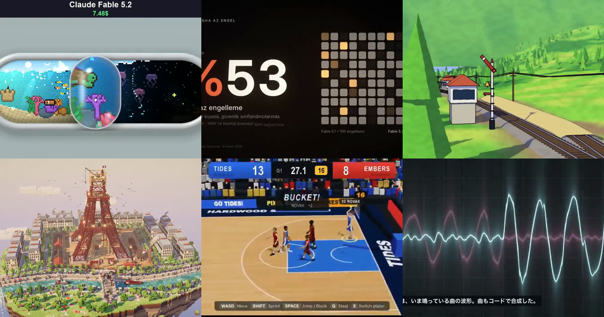

<div align="center">

<a href="https://apiko.app/claude-fable-5-2-video-prompts?utm_source=github&utm_medium=banner&utm_campaign=awesome-claude-fable-5.2-video-prompts"></a>

[](LICENSE)
[](README.md#menu)
[](https://apiko.app/models/claude-fable-5-2?utm_source=github&utm_medium=badge&utm_campaign=awesome-claude-fable-5.2-video-prompts&utm_content=model_try)
[](https://apiko.app/docs/api-manual/text-series/claude?utm_source=github&utm_medium=badge&utm_campaign=awesome-claude-fable-5.2-video-prompts&utm_content=docs)

[](README.md)
[](README_zh-CN.md)
[](README_zh-TW.md)
[](README_ko.md)

</div>

# Awesome Claude Fable 5.2 Video Prompts

<a id="introduction"></a>
## 🌟 Introduction

**Claude Fable 5.2 video prompts: 33 real prompts with the videos they made, from WebGL sliders and Three.js scenes to Blender anime and LilyPond music.**

Claude Fable 5.2 video prompts collected from creators in the first days after launch. Every card has the exact prompt the creator posted and the video it produced, so you can copy one and compare. Every result video plays right here on GitHub.

Search and filter them on [apiko.app/claude-fable-5-2-video-prompts](https://apiko.app/claude-fable-5-2-video-prompts?utm_source=github&utm_medium=readme&utm_campaign=awesome-claude-fable-5.2-video-prompts&utm_content=intro).

> [!NOTE]
> Each prompt is kept exactly as its author posted it, so most are in English; titles and descriptions are ours. Every case credits the author and links to the original post.

<a id="quick-start"></a>
## 🚀 Quick start

**In the browser:** every case has a **Run on APIKO** link. It opens the example on [apiko.app](https://apiko.app/claude-fable-5-2-video-prompts?utm_source=github&utm_medium=quickstart&utm_campaign=awesome-claude-fable-5.2-video-prompts&utm_content=browser); press **Use** there to load the prompt into the Claude Fable 5.2 playground.

**With the API:** create an [APIKO API key](https://apiko.app/dashboard/apikeys?utm_source=github&utm_medium=quickstart&utm_campaign=awesome-claude-fable-5.2-video-prompts&utm_content=api_key) and send the prompt to the Messages API. Claude replies with code; run it on your machine to render the video.

```bash
export APIKO_API_KEY="your_key_here"

curl -s https://api.apiko.app/v1/messages \
  -H "Authorization: Bearer $APIKO_API_KEY" \
  -H "anthropic-version: 2023-06-01" \
  -H "Content-Type: application/json" \
  -d '{
  "model": "claude-fable-5-2",
  "max_tokens": 16000,
  "messages": [{
    "role": "user",
    "content": "Write one self-contained index.html that animates a paper boat crossing a lake at sunrise for 10 seconds at 1920x1080, plus the Playwright and FFmpeg commands that render it to boat.mp4."
  }]
}' | python3 -c 'import json,sys; print("".join(b.get("text","") for b in json.load(sys.stdin)["content"]))'
```

Endpoints: `POST https://api.apiko.app/v1/messages` (send a prompt)

<a id="how-to-write"></a>
## ✍️ How to write Claude Fable 5.2 video prompts

Claude Fable 5.2 writes code, not video files. The code is rendered on your machine and captured as frames. Decide the route first and name it in the prompt.

- **One self-contained page** · `Single HTML file + WebGL or Canvas + Web Audio + "no libraries"` — The two volume-slider cards ask for one page with raw WebGL2, Web Audio and a pixel buffer. A page like this can be opened in a browser and screen-recorded.
- **Three.js with a frame clock** · `Scene + length + size + fps + window.renderAt(t)` — The voxel Paris card exposes renderAt(t) so every frame can be captured at a fixed rate. Ask for it whenever the video has to be exact rather than a live recording.
- **Remotion or HyperFrames** · `Framework + length + what to sell + project folder` — Trailer cards name HyperFrames or Remotion and run inside the project, so the model reads the real product before it writes the film.
- **Blender and LilyPond** · `Tool + subject + render settings, or "only the code block"` — The anime short builds every shot in Blender from Python; the music cards ask for LilyPond code only. Both need the tool installed locally to turn the code into a video.
- **What to state every time** · `Length + resolution + fps + effort + assets you supply` — Cards that gave a length got it. Say which assets you bring (a song, lyrics, a project folder, a reference video), because five cards here depend on them.

**What the Claude Fable 5.2 examples show**

- **One sentence can be enough** The UFO, the logo reveal and the "code only" launch film came from one line. Long specs are for exact looks, like the 6,000-character slider studies.
- **Creators report the cost** The two sliders cost $7.48 and $8.43, and the self-made launch film about $21 at API prices over 57 minutes. Budget for long runs.
- **Long work runs as an agent** The 60-second launch film used Opus 5.5 subagents and the crime game took over two hours. Run these in Claude Code or another agent loop, not one API call.
- **Effort matters** The music cards used Extra High, the wizard film high, the trailer medium. Fable 5.2 thinks on every request and defaults to high.
- **Opus 5.5 is still close** Two creators ran the same prompt on both models and one preferred the Opus 5.5 result. Compare on your own idea before switching.

<a id="menu"></a>
## 📑 Menu

- [✨ Motion graphics](#motion-graphics) (12)
  - [Two short prompts for a goodbye showreel to Opus 5.5](#motion-graphics-01)
  - [Particle letters that become a galaxy, a helix and your name](#motion-graphics-02)
  - [A volume slider that dives into an underwater world](#motion-graphics-03)
  - [A night-to-morning slider with a cozy room inside](#motion-graphics-04)
  - [A chrome-metal 3D logo reveal](#motion-graphics-05)
  - [The one-line 15-second motion designer showreel](#motion-graphics-06)
  - [A 30-second motion design portfolio reel with its own music](#motion-graphics-07)
  - [A showcase film: technique first, then the feelings](#motion-graphics-08)
  - ["Show me the strongest video you can make"](#motion-graphics-09)
  - [Rocket science for a high-school audience, in one shot](#motion-graphics-10)
  - [The pelican-on-a-bicycle test, drawn in SVG](#motion-graphics-11)
  - [A traffic light on a one-way street, simulated in Python](#motion-graphics-12)
- [🚀 Launch and promo](#product-launch) (5)
  - [A 60-second launch film made with Opus 5.5 subagents](#product-launch-01)
  - ["Make your own launch video. Code only."](#product-launch-02)
  - [A social trailer for a course, built with HyperFrames](#product-launch-03)
  - [A keynote-style promo film for a knowledge site, one prompt](#product-launch-04)
  - [A launch video for BlewUp, styled after a reference](#product-launch-05)
- [🎞️ Short film](#short-film) (6)
  - [A steam locomotive that turns into a robot, as 2D anime](#short-film-01)
  - [A UFO lands at Area 51 and greets humans](#short-film-02)
  - [A little wizard creates and releases Fable 5.2](#short-film-03)
  - [A sabertooth cat hunts a bison, code only](#short-film-04)
  - [Human art history in one 60-second continuous shot](#short-film-05)
  - ["936": a short film that counts the weekends of a life](#short-film-06)
- [• 3D scenes](#3d-scenes) (4)
  - [An immersive 3D model of ancient Jerusalem in Blender](#3d-scenes-01)
  - [A floating voxel Paris of 1888, rendered frame by frame](#3d-scenes-02)
  - [Photorealistic honey, simulated in WebGL](#3d-scenes-03)
  - [A Raspberry Pi 5 that takes itself apart](#3d-scenes-04)
- [• Games](#games) (2)
  - [A one-shot 3D basketball game in Three.js](#games-01)
  - [An open-world crime game in an 80s Miami-style city](#games-02)
- [• Music](#music) (4)
  - [A Bach-style chorale in G minor, written in LilyPond](#music-01)
  - [A Japanese lyric motion video from a song and its lyrics](#music-02)
  - [From a point to a world: a shader film with a coded song](#music-03)
  - [A complete organ fugue in the style of Bach, in LilyPond](#music-04)
- [❓ FAQ](#faq)
- [🔗 Related](#related)

<a id="motion-graphics"></a>
## ✨ Motion graphics

> Showreels, logo reveals, UI switches and explainers drawn in HTML, SVG, WebGL and shaders. · 12 cases

<a id="motion-graphics-01"></a>
### 1. Two short prompts for a goodbye showreel to Opus 5.5

by [@kaif9998](https://x.com/kaif9998) · 15s · 16:9 · **[▶ Run on APIKO](https://apiko.app/claude-fable-5-2-video-prompts?utm_source=github&utm_medium=case&utm_campaign=awesome-claude-fable-5.2-video-prompts&utm_content=motion-graphics-01#motion-graphics-01)** · [Original post](https://x.com/kaif9998/status/2119903824848761287)

Run in Claude Code: one line asks for a 15-second farewell video, a second line asks to make it a showreel.

https://github.com/user-attachments/assets/9e5b1c2c-c8a4-42e2-8e4a-b09d24ed1cc7

**Prompt:**

```text
Claude Code , two prompts:

1. "make a 15 second animated video that says final goodbye to Opus 5.5 as Fable 5.2 is here and I switched to it"
2. "make the video like it's your showreel"
```

<a id="motion-graphics-02"></a>
### 2. Particle letters that become a galaxy, a helix and your name

by [@ici_dab](https://x.com/ici_dab) · 68s · 1:1 · **[▶ Run on APIKO](https://apiko.app/claude-fable-5-2-video-prompts?utm_source=github&utm_medium=case&utm_campaign=awesome-claude-fable-5.2-video-prompts&utm_content=motion-graphics-02#motion-graphics-02)** · [Original post](https://x.com/ici_dab/status/2119901910237098351)

An open brief: make the most impressive shareable thing you can. The result is an interactive particle piece with its own music.

https://github.com/user-attachments/assets/87dcae6e-5db0-493b-af51-7728f885e228

**Prompt:**

```text
the prompt: "I need you to create the most impressive thing I can share with people when you launch. It needs to be embeddable in a post and i can preface it however you like. it needs to have a visceral impact on people to show what you can do and the range of capabilities. It should grab them quickly. Be amazingly clever about this."
```

<a id="motion-graphics-03"></a>
### 3. A volume slider that dives into an underwater world

by [@N1njaCodex](https://x.com/N1njaCodex) · 11s · 16:9 · **[▶ Run on APIKO](https://apiko.app/claude-fable-5-2-video-prompts?utm_source=github&utm_medium=case&utm_campaign=awesome-claude-fable-5.2-video-prompts&utm_content=motion-graphics-03#motion-graphics-03)** · [Original post](https://x.com/N1njaCodex/status/2119883560937001387)

A long spec for a WebGL2 and Web Audio switch with no libraries. The author reports $7.48 for the run.

https://github.com/user-attachments/assets/881af4cb-a87b-4dc0-a277-595d823729f8

**Prompt:**

```text
Make "Deep Dive Switch", No. 063 in a series of web material studies: a depth switch that goes from light to dark, from the sea's surface to the floor of the abyss. Build it as one self-contained page with no libraries: raw WebGL2, Web Audio and a 2D pixel buffer.

PAGE
- Editorial layout: a small kicker "Material Studies / No. 063 · WebGL + Web Audio", an italic serif title "Deep Dive Switch.", and a one-line caption.
- The switch sits centred and large. Below it go three readouts (Depth, Zone, Music), a hint line and a "Sound on/off" button.
- The whole page's colours (background, text, lines) follow the depth: pale aqua at the surface, near-black blue in the abyss.
- It must work at phone width.

THE SWITCH
- A pill-shaped switch in a moulded bezel: white glossy plastic at the surface, deep navy in the abyss.
  - A soft drop shadow falls on the page and fades to nothing before the canvas edge.
  - A slight inner shadow runs along the top of the track.
- Inside it is a 176×50 pixel-art cross-section of the sea.
  - Redraw it every frame on the CPU and show it with nearest sampling, never smoothed.
  - Use whole device pixels per scene pixel where there is room.
- The knob is a glass bathysphere: a vertical capsule of clear glass, a little taller than the track, drawn in a single full-canvas WebGL2 fragment shader.
  - It magnifies what is under it (about 1.28×) and bends it.
  - At its rim it splits R, G and B. A darker refraction band sits inside a bright edge, with a Fresnel tint and a faint aqua cast.
  - Two highlights: a long soft streak at the upper left and a small dot at the lower right.
  - Light gathers toward its foot, and it casts a soft shadow on the scene.
- Motion:
  - It follows the finger on a spring, lagging a little.
  - It stretches sideways with speed and squashes vertically to keep its volume.
  - It wobbles on a damped spring driven by its acceleration.
- Controls:
  - Drag the knob, or drag anywhere on the track.
  - Tap to send it to the other end; it travels there on its spring.
  - Arrow keys, Home/End and Space/Enter also work.
  - The switch has role="slider" with ARIA values.

THE SEA (left = shallow, right = deep; an original palette)
- Sprites are filled shapes stamped with an automatic 1-px outline and a light top / dark bottom.
- The sea floor, left to right:
  - a sandy beach with a sandcastle;
  - a reef plateau with rocks;
  - a drop-off into rocky deep water;
  - the abyssal floor rising again at the far right.
- Up top on the left is sky with a sun, two flapping gulls and a little red sailboat bobbing on animated waves with a foam line.
  - The surface is level over the shallows, then rises out of the picture toward the deep, so the view seems to sink.
- The shallows:
  - turquoise water with swaying slanted god rays and moving caustics on the sand;
  - branching corals in pink, orange and violet, brain corals, swaying sea grass;
  - an anemone with a little orange-and-white fish darting about it;
  - a sea turtle gliding back and forth, paddling;
  - a school of yellow fish circling over the reef that scatters away from the knob.
- The twilight zone:
  - the water darkens to deep blue;
  - three translucent jellyfish, pink and violet, pulse and trail wavy tentacles; they glow softly and pulse faster when the knob comes near;
  - every half minute a faint whale silhouette swims past in the background.
- The midnight zone:
  - a long swaying chain of glowing cyan-and-green beads (a siphonophore);
  - small dark lanternfish with blinking light spots;
  - marine snow drifting down.
- The abyssal floor:
  - a hydrothermal vent breathing bubbles;
  - an anglerfish with a rod and a glowing lure;
  - a treasure chest.

LIGHT AND THE DIVE
- Daylight falls off with depth and dims a little toward the floor. It is quantised and Bayer-dithered so the gradient steps like pixel art.
- Below the shallows the bathysphere's searchlight comes on: a stepped, dithered pool of light around the knob, with a blue haze scattered in the water.
- Inside the lens everything is shown lit.
- Behind the knob trail rising bubbles and, in the dark, sparks of blue bioluminescence.
- Glowing crescent echoes trail behind it: pale aqua in the shallows, cyan in the deep.
- The lure lights its own little pool.
- As the knob nears, the anglerfish turns and opens its toothy mouth wide, and its lure blazes.
- At the very bottom the chest lid swings open on glowing gold, and gold glints fly up from it.

SOUND — all synthesised live with Web Audio, original music
- 84 BPM, a four-bar loop in D minor (Dm7 · B♭maj7 · Gm7 · A7sus4), on one lookahead-scheduled clock with a little swing.
- Layers fade in and out with depth:
  0. The surface: waves (filtered noise swelling slowly) and gull cries. The moment you go under, a splash, and the waves drop to a dull underwater roar.
  1. The reef: a kalimba ostinato (sine with bright, quickly fading overtones, in a long reverb), with bubbles popping on the off-beats.
  2. A soft dub beat: a round kick, rim clicks into a dotted echo, a swung shaker, a deep bass.
  3. The twilight: slow detuned pads, a whale singing now and then (a gliding, vibrato tone through a formant filter), then sonar pings ringing in the echo.
  4. The abyss: a breathing sub drone, a slow lub-dub heartbeat, and glassy arpeggios of high pentatonic notes ringing in the echo.
- The music sits behind a gentle low-pass that closes a little with depth, about 5 dB under the switch's own sounds.
- Switch sounds:
  - a bubble bloop when grabbed, a plop when released;
  - a water swish and bubble pops that grow with drag speed;
  - a splash crossing the surface either way;
  - a glass chime past each jellyfish;
  - the angler's deep gulp;
  - a fanfare when the chest opens: a rising kalimba arpeggio, a low boom and a shimmer.
- Audio starts on the first touch; a Sound on/off button.

READOUTS
- Depth, 0 → 6,000 m, mapped to the zones.
- Zone: Surface / Sunlit / Twilight / Midnight / Abyss.
- Music: Waves / Kalimba / Reef dub / Whale song / Sonar / Abyss.
```

<a id="motion-graphics-04"></a>
### 4. A night-to-morning slider with a cozy room inside

by [@vib3coded](https://x.com/vib3coded) · 13s · 16:9 · **[▶ Run on APIKO](https://apiko.app/claude-fable-5-2-video-prompts?utm_source=github&utm_medium=case&utm_campaign=awesome-claude-fable-5.2-video-prompts&utm_content=motion-graphics-04#motion-graphics-04)** · [Original post](https://x.com/vib3coded/status/2119876781700505627)

Same material-study format: one self-contained page in WebGL2 and Web Audio. The author reports 10 minutes and $8.43.

https://github.com/user-attachments/assets/43693a77-956f-4518-87de-c64e9c99b327

**Prompt:**

```text
Make "Daybreak Switch", No. 062 in a series of web material studies: a night-to-morning toggle in its own original style, as a single self-contained page (no libraries; raw WebGL2 + Web Audio + a 2D pixel buffer). Editorial layout: a small "Material Studies / No. 062 · WebGL + Web Audio" kicker, an italic serif title "Daybreak Switch.", a one-line caption; the switch centred and large; below it readouts (Clock, Light, Music), a hint line and a "Sound on/off" button. The whole page's colours (background, text, lines) follow the switch from a dark dusk-indigo at night to a pale lavender-grey by day. Works at phone width.

THE SWITCH
- A pill-shaped switch in a moulded bezel: white glossy plastic by day, graphite by night. A soft drop shadow falls on the page and fades to nothing before the canvas edge, with a slight inner shadow along the top of the track.
- Inside, a 176×50 pixel-art room, redrawn every frame on the CPU and shown with nearest sampling, never smoothed. Whole device pixels per scene pixel where there is room.
- The knob is a vertical capsule of clear jelly glass, a little taller than the track, drawn in one full-canvas WebGL2 fragment shader:
  - it magnifies (~1.28×) and bends the pixels under it;
  - it splits R/G/B at its rim, with a darker refraction band, a bright edge and a Fresnel tint;
  - two highlights: a long soft streak at the upper left and a small dot at the lower right;
  - light focused toward its foot, and a soft shadow on the room.
- The knob lags the finger on a spring, stretches horizontally with speed (squashing vertically to keep its volume), and wobbles on a damped spring fed by its acceleration.
- Inside the knob the room is always shown fully lit: the glass carries the morning.
- Controls: drag the knob or drag anywhere on the track; tap to toggle to the other end (it travels there on its spring); arrow keys, Home/End, Space/Enter; role="slider" with aria values.

THE ROOM (original, cosy palette)
Built from filled shapes stamped with an automatic 1-px outline and a light top / dark bottom, so every object reads as a pixel sprite:
- butter-yellow diamond wallpaper, teal wainscot, plank floor, a coral/cream/teal striped rug;
- a big window with curtains over a town of roofs;
- a shelf of coloured jelly jars and books, a potted plant;
- a brass floor lamp with a mint shade;
- a red boombox on a wooden cabinet, a framed picture of a little jelly shark, a round wall clock, a blue panelled door;
- a string of coloured bulbs sagging across the ceiling;
- a purple pet bed under the window.

LIGHT AND THE MORNING
- The knob drags the dawn across the room: left of it is day, right of it still night (indigo ambient). The edge dissolves in a 4×4 Bayer dither, with a warm dawn band just behind the knob.
- The window sky runs from night (navy, twinkling stars, a crescent moon, lit town windows) through dawn (violet to peach, the sun coming up) to day (blue, sun high, clouds drifting).
- Moonlight shafts through the window at night, warm sun shafts by day.
- The lamp clicks on early and casts a banded warm pool.
- Each ceiling bulb lights as the knob passes it, with a coloured dithered glow.
- Disco spots sweep the room at the party.
- The wall clock runs from 02:00 to 10:00.

THE STORY, BY POSITION
- An orange tabby cat:
  - asleep, curled in its bed, breathing, with z's rising;
  - awake, lying with its head up and blinking;
  - sitting up;
  - standing and walking out onto the rug;
  - at the end dancing on its hind legs to the beat, in sunglasses, with pink ghost trails.
- The plant sways and the boombox speakers thump with the beat; music notes float up from the boombox.
- A disco ball comes down from the ceiling; confetti sparkles fall.
- Glowing crescent echoes (coral to pink) trail behind the moving knob.
- Near the end (from about 08:24 on the clock) a puppy waits outside: warm light shows under the door with the shadows of its shifting paws, and it knocks. On each knock the door jolts 2 px, arcs of sound spring off it, and a "!" pops up over the cat; the knocking repeats every ~2.8 s until it's let in. At the very end the door swings open on a warm orange hallway and a white puppy with brown ears comes in, bobbing to the beat.

SOUND — all synthesised live with Web Audio, original music
- 100 BPM, a four-bar loop in F (Fmaj7 · Am7 · Dm7 · B♭maj7), on one lookahead-scheduled clock with a little swing.
- Layers fade in by the knob's position:
  0. Night: crickets (AM-chirped sine trains) and soft wind.
  1. A music box arpeggiating the chords (bell partials, short room reverb).
  2. A lo-fi beat (kick, noise-and-tone snare, hats) and a round bass.
  3. Warm detuned pads and a square-wave tune with vibrato.
  4. The party: four on the floor, claps, open hats, sub bass, the rest of the mix pumping under the kick.
- The music sits behind a low-pass that opens with the dawn, and ~5 dB under the switch's own sounds.
- Switch sounds:
  - a glass tink plus a jelly blop when grabbed, a plop when released;
  - a band-passed noise rub following the drag speed;
  - a pentatonic pluck for every bulb lit (a glissando when you sweep across), softer and lower when one goes out;
  - the lamp's double click and a cat's "mrrp" (formant-filtered saw) when it wakes;
  - a riser and crash into the party, and a record-brake when you drag back out of the beat;
  - the puppy's yip when it comes in.
- The knock, like a real heavy door knock: three hits 0.25 s apart, panned toward the door. Each hit is a knuckle click (band-passed noise) over a deep thump that sags from ~98 to ~60 Hz over a quarter second, with quicker overtones (190→128 Hz, 410 Hz) and soft saturation so small speakers hear it. The music ducks to ~45% under each hit, and the knocks peak at 3–4× the music's level.
- Audio starts on the first touch; a Sound on/off button.
- Readouts: Clock (02:00–10:00), Light (Night / First light / Sunrise / Morning / Party), Music (Crickets / Music box / Beat / Band / Party).
```

<a id="motion-graphics-05"></a>
### 5. A chrome-metal 3D logo reveal

by [@hello_amani](https://x.com/hello_amani) · 36s · 1:1 · **[▶ Run on APIKO](https://apiko.app/claude-fable-5-2-video-prompts?utm_source=github&utm_medium=case&utm_campaign=awesome-claude-fable-5.2-video-prompts&utm_content=motion-graphics-05#motion-graphics-05)** · [Original post](https://x.com/hello_amani/status/2119873980786237842)

One sentence: reveal my logo in 3D with chromatic metal, grids and many iterations.

https://github.com/user-attachments/assets/a73ee82d-e624-4214-822d-db0306296688

**Prompt:**

```text
the prompt was: make my logo reveal in 3D with chromatic metal and grids
and bunch of iteration
```

<a id="motion-graphics-06"></a>
### 6. The one-line 15-second motion designer showreel

by [@himanshutwtxs](https://x.com/himanshutwtxs) · 15s · 16:9 · **[▶ Run on APIKO](https://apiko.app/claude-fable-5-2-video-prompts?utm_source=github&utm_medium=case&utm_campaign=awesome-claude-fable-5.2-video-prompts&utm_content=motion-graphics-06#motion-graphics-06)** · [Original post](https://x.com/himanshutwtxs/status/2120017106804900304)

The same sentence many people ran on Opus 5.5, now on Fable 5.2: easing, type, depth and timing in one reel.

https://github.com/user-attachments/assets/e708f162-826c-4b84-86d5-3ca6a64080d3

**Prompt:**

```text
make a dynamic 15-second motion graphics video that shows what an incredible motion designer you are, like it's your showreel for a résumé. go all out
```

<a id="motion-graphics-07"></a>
### 7. A 30-second motion design portfolio reel with its own music

by [@Leviwoyun](https://x.com/Leviwoyun) · 30s · 16:9 · **[▶ Run on APIKO](https://apiko.app/claude-fable-5-2-video-prompts?utm_source=github&utm_medium=case&utm_campaign=awesome-claude-fable-5.2-video-prompts&utm_content=motion-graphics-07#motion-graphics-07)** · [Original post](https://x.com/Leviwoyun/status/2119955625820258308)

Chinese prompt: a 30-second reel that proves you are an outstanding motion designer, made like a résumé portfolio piece. The author reports 24 minutes for the motion and the music.

https://github.com/user-attachments/assets/8a25fd28-1ad4-4b78-b175-41758d66148b

**Prompt:**

```text
制作一段 30 秒动态图形短片，展现作为动态设计师出众的实力，就当做用于简历的个人作品集，请尽情发挥
```

<a id="motion-graphics-08"></a>
### 8. A showcase film: technique first, then the feelings

by [@rute1203d](https://x.com/rute1203d) · 146s · 16:9 · **[▶ Run on APIKO](https://apiko.app/claude-fable-5-2-video-prompts?utm_source=github&utm_medium=case&utm_campaign=awesome-claude-fable-5.2-video-prompts&utm_content=motion-graphics-08#motion-graphics-08)** · [Original post](https://x.com/rute1203d/status/2120077147872391540)

Japanese prompt: you are one of the world's top video creators; show off your technique, then move the viewer. The author did not expect the turn in the second half.

https://github.com/user-attachments/assets/c25fc8ca-af85-42fc-afd6-301dd48858f2

**Prompt:**

```text
あなたが世界有数の動画クリエイターです...
今の実力を見せつける最高の動画を作ってください
技術をみせその後感動を見せる
```

<a id="motion-graphics-09"></a>
### 9. "Show me the strongest video you can make"

by [@suna_gaku](https://x.com/suna_gaku) · 89s · 16:9 · **[▶ Run on APIKO](https://apiko.app/claude-fable-5-2-video-prompts?utm_source=github&utm_medium=case&utm_campaign=awesome-claude-fable-5.2-video-prompts&utm_content=motion-graphics-09#motion-graphics-09)** · [Original post](https://x.com/suna_gaku/status/2119952985933697063)

A one-line Japanese prompt. In an earlier post the author says the model started by composing the song, then built fractals, fluid and sound scenes around it.

https://github.com/user-attachments/assets/265a9dcb-7304-430e-b8c2-d9a4680c0c03

**Prompt:**

```text
今の実力を見せつける最強の動画を見せて
```

<a id="motion-graphics-10"></a>
### 10. Rocket science for a high-school audience, in one shot

by [@Hunter_Weiss](https://x.com/Hunter_Weiss) · 118s · 16:9 · **[▶ Run on APIKO](https://apiko.app/claude-fable-5-2-video-prompts?utm_source=github&utm_medium=case&utm_campaign=awesome-claude-fable-5.2-video-prompts&utm_content=motion-graphics-10#motion-graphics-10)** · [Original post](https://x.com/Hunter_Weiss/status/2119932937642946900)

One prompt asks for the most shareable video about Fable 5.2 that explains rocket science at a high-school level. The result is two minutes of captioned diagrams.

https://github.com/user-attachments/assets/74f751a4-8927-4248-b604-8d0160907c32

**Prompt:**

```text
I need you to create the most impressive video I can share with people about Fable 5.2, explaining rocket science as if it were for someone with a high school education.
```

<a id="motion-graphics-11"></a>
### 11. The pelican-on-a-bicycle test, drawn in SVG

by [@leo114119](https://x.com/leo114119) · 31s · 2:1 · **[▶ Run on APIKO](https://apiko.app/claude-fable-5-2-video-prompts?utm_source=github&utm_medium=case&utm_campaign=awesome-claude-fable-5.2-video-prompts&utm_content=motion-graphics-11#motion-graphics-11)** · [Original post](https://x.com/leo114119/status/2119943368079802645)

A Chinese prompt the author found on Bilibili: one HTML file with an SVG pelican riding a bicycle. Run on MAX, it came out natural and smooth, with less realistic detail than earlier attempts.

https://github.com/user-attachments/assets/63884b16-478d-4912-95df-57364209c6c5

**Prompt:**

```text
创建一个Html文件，使用svg 绘制一只鹈鹕骑自行车的动画
```

<a id="motion-graphics-12"></a>
### 12. A traffic light on a one-way street, simulated in Python

by [@diegocabezas01](https://x.com/diegocabezas01) · 26s · 16:9 · **[▶ Run on APIKO](https://apiko.app/claude-fable-5-2-video-prompts?utm_source=github&utm_medium=case&utm_campaign=awesome-claude-fable-5.2-video-prompts&utm_content=motion-graphics-12#motion-graphics-12)** · [Original post](https://x.com/diegocabezas01/status/2119978348440866912)

One sentence at High effort: cars arrive at a random rate and queue at the light, with a live chart of the queue. The author ran the same prompt on GPT-6 Astra and says both did a great job.

https://github.com/user-attachments/assets/45de3523-a584-4c66-96aa-0d9284cdbeb2

**Prompt:**

```text
write a python code that visualizes how a traffic light works in a one way street with cars entering at random rate.
```

<a id="product-launch"></a>
## 🚀 Launch and promo

> Launch films and trailers, from a one-line "code only" brief to a project folder the model researches first. · 5 cases

<a id="product-launch-01"></a>
### 13. A 60-second launch film made with Opus 5.5 subagents

by [@grafikcem](https://x.com/grafikcem) · 60s · 16:9 · **[▶ Run on APIKO](https://apiko.app/claude-fable-5-2-video-prompts?utm_source=github&utm_medium=case&utm_campaign=awesome-claude-fable-5.2-video-prompts&utm_content=product-launch-01#product-launch-01)** · [Original post](https://x.com/grafikcem/status/2119910525064937806)

Turkish prompt: on launch day, use Opus 5.5 subagents to make a 60-second animated film about Fable 5.2.

https://github.com/user-attachments/assets/5c70cca9-79e2-41f0-85a5-cc7a75118cd4

**Prompt:**

```text
Bugün duyurulmana özel Fable 5.2 modeli için opus 5.5 subagentları kullanarak kendine 60 saniyelik bir tanıtım animasyon filmi hazırla.
```

<a id="product-launch-02"></a>
### 14. "Make your own launch video. Code only."

by [@furkancavlakcom](https://x.com/furkancavlakcom) · 74s · 16:9 · **[▶ Run on APIKO](https://apiko.app/claude-fable-5-2-video-prompts?utm_source=github&utm_medium=case&utm_campaign=awesome-claude-fable-5.2-video-prompts&utm_content=product-launch-02#product-launch-02)** · [Original post](https://x.com/furkancavlakcom/status/2119896886345695521)

One Turkish sentence. The author reports 57 minutes, about $21 at API prices, 1,702 lines of Python, 2,220 frames and synthesized music.

https://github.com/user-attachments/assets/73630cf7-74c1-40a2-8661-01130ec49748

**Prompt:**

```text
Kendi lansman videonu yap. Sadece kodla.
```

<a id="product-launch-03"></a>
### 15. A social trailer for a course, built with HyperFrames

by [@midudev](https://x.com/midudev) · 32s · 9:16 · **[▶ Run on APIKO](https://apiko.app/claude-fable-5-2-video-prompts?utm_source=github&utm_medium=case&utm_campaign=awesome-claude-fable-5.2-video-prompts&utm_content=product-launch-03#product-launch-03)** · [Original post](https://x.com/midudev/status/2119876297304203273)

Spanish prompt run inside the author's project: sell it with sound and bold animation, medium effort. About 10 minutes.

https://github.com/user-attachments/assets/8066c1f5-8a96-4b12-8810-a3c7dd64175d

**Prompt:**

```text
El prompt:  Crea un trailer en video animado para compartir en redes sociales de este proyecto. Quiero que lo vendas de forma espectacular, que tenga sonido y animaciones brutales. Usa hyperframes.

Esfuerzo medio.
```

<a id="product-launch-04"></a>
### 16. A keynote-style promo film for a knowledge site, one prompt

by [@czzzzzzJ_](https://x.com/czzzzzzJ_) · 298s · 16:9 · **[▶ Run on APIKO](https://apiko.app/claude-fable-5-2-video-prompts?utm_source=github&utm_medium=case&utm_campaign=awesome-claude-fable-5.2-video-prompts&utm_content=product-launch-04#product-launch-04)** · [Original post](https://x.com/czzzzzzJ_/status/2120023093464682817)

Chinese prompt run in the site's project folder: research the business, ask one round of questions, then deliver an Apple-keynote style film.

https://github.com/user-attachments/assets/591923c2-ce88-4a12-a29b-0d834d5d0200

**Prompt:**

```text
你现在在我的知识站项目目录下，完整地调研我知识站上所有的业务、提供的内容，以及我的商业模式。使用 opuscar这个库帮我生成我的知识站宣传视频，整体风格我希望是像苹果的发布会那种风格质感。素材可以自行搜索和获取截屏。关于我不了解的内容，DOC 文件夹下有我的个人介绍。在整个宣传片制作前，你有一次向我提问的机会，收集我的想法，然后我要求你直接成片。
```

<a id="product-launch-05"></a>
### 17. A launch video for BlewUp, styled after a reference

by [@wangray](https://x.com/wangray) · 19s · 16:9 · **[▶ Run on APIKO](https://apiko.app/claude-fable-5-2-video-prompts?utm_source=github&utm_medium=case&utm_campaign=awesome-claude-fable-5.2-video-prompts&utm_content=product-launch-05#product-launch-05)** · [Original post](https://x.com/wangray/status/2120040640423850168)

A one-line Chinese prompt: make a similar video for BlewUp in the style of this launch video. You bring the reference video and your own product.

https://github.com/user-attachments/assets/a206b89f-5df7-44db-aca2-df94a0c86717

**Prompt:**

```text
参考这个 launch video 风格给 BlewUp 做一个类似的视频
```

<a id="short-film"></a>
## 🎞️ Short film

> Stories told in code: Blender anime, a Three.js UFO, a wildlife hunt and a one-take tour of art history. · 6 cases

<a id="short-film-01"></a>
### 18. A steam locomotive that turns into a robot, as 2D anime

by [@0kncn](https://x.com/0kncn) · 90s · 16:9 · **[▶ Run on APIKO](https://apiko.app/claude-fable-5-2-video-prompts?utm_source=github&utm_medium=case&utm_campaign=awesome-claude-fable-5.2-video-prompts&utm_content=short-film-01#short-film-01)** · [Original post](https://x.com/0kncn/status/2119901782482543073)

A long spec: build everything in Blender from Python, render in Eevee, ink and paint each frame, and synthesize the music. 90 seconds.

https://github.com/user-attachments/assets/0190d27a-1663-40f4-bf7a-8bef95c16d03

**Prompt:**

```text
Create a 2D anime short. It must look completely like real Japanese anime, as if it were taken directly from a finished theatrical anime film. This is traditional-looking, hand-drawn 2D anime, not a 3D animation, a moving illustration, or a stylized web graphic.

Build everything in Blender from Python, render it in Eevee, then ink and paint every frame in a second pass. Deliver one 1920x1080, 24 fps MP4 with a synthesized soundtrack. Use any tools, libraries, references, guides, literally anything, as long as the final result looks 100% like hand-drawn 2D anime.

Use theatrical anime as the art style reference for the design, line work, painted backgrounds, color and atmosphere. The film is 90 seconds long (2160 frames), in 42 shots. Its hero is a steam locomotive that transforms into a robot. No people appear in the film.

HERO
No. 9, a 1940s 2-8-2 freight locomotive with a four-axle tender, 23 m long, asleep for decades in a mountain engine shed: matte black boiler with rust runs, faded red wheel centres and buffer beam, brass number plate "9", one large headlamp, two amber marker lamps, moss on the running boards, ivy through the cab windows, and a stork's nest on the cab roof. As a robot it stands 21 m tall with its shoulders at 17 m. It is an original design, not a character from any existing series. It moves on twos, slow and heavy. Its wheels never slip and its feet never slide.

TRANSFORM
One transformation, at full speed, 120 frames, in five stages of 24 frames. Every part is rigid: nothing stretches, nothing vanishes, nothing appears. Each part travels on a hinge or a slide you can see.
1. Legs: the tender uncouples, splits lengthwise and swings down; its two bogies lock as feet, the coal stays in bunkers on the calves.
2. Hips: the cab drops and widens into the pelvis; the trailing truck folds onto the lower back.
3. Torso: the boiler tilts upright, firebox at the waist, smokebox at the top; the chimney and steam dome end on the upper back and keep venting.
4. Arms: the running boards swing out with the cylinders as shoulders, the piston and connecting rods as forearms, and hands with three fingers and a thumb unfolding from the valve gear; the front driving wheels ride up as shoulder discs, the rear ones fold to hips and knees.
5. Head: the smokebox door hinges forward as the chest plate with the headlamp at its centre; a riveted helmet rises from the smokebox with one dark visor slit and the two marker lamps as amber eyes; the cowcatcher folds up as a collar.
The cab roof panel rides up to the right shoulder and carries the stork's nest, never tilted more than 10 degrees.
Stages 1-3 happen on the rails, with the first strides landing on the ballast either side of the track. Stages 4-5 happen in the air.

WORLD
A single-track mountain railway at real scale. At the top, an ore mine with a loading bunker and a rake of twelve four-wheel hopper wagons. The line descends through larch forest and a short rock tunnel to a viaduct: seven 18 m steel girder spans on stone piers, 126 m long, the deck 17 m above a turquoise meltwater river 3 m deep. Beyond it, a small station: a stone engine shed, a water tower, a semaphore signal with an alarm bell, a signal box, a siding ending in a sand drag. Snow peaks behind, a cliff face above the viaduct, telegraph poles along the whole line.

STORY
A clear spring morning in the valley. Meltwater loosens the cliff: a rockfall hits the middle pier of the viaduct, the pier collapses into the river and the two girders it carried sag into a V, held only by the rails. Up at the mine the shock snaps a coupling and the twelve loaded wagons start to roll downhill, unmanned. At the station the semaphore drops to danger and the bell rings. In the dark shed the firebox glows, the pressure needle climbs, the headlamp lights; the stork flies up. No. 9 bursts through the shed doors tearing ivy and rust, and charges up the grade with the wagons coming down the other side. On the approach it transforms at full speed, leaps from the abutment, lands crouched in the river, wades to the fallen pier, and lifts the sagging joint onto its shoulders and raised hands. The wagons hit the viaduct: it sinks 0.3 m as each one passes over and holds. The rake runs through the station into the sand drag and stops. No. 9 does not come back out. It locks its knees and stays as the new pier. The steam thins, the stork returns to its nest, the visor dims.

LIGHT
High-key anime light, never murky: a morning sun from the south-east, a saturated cobalt sky, white cumulus with lavender shadows, snow peaks with blue shadows, fresh green larch, a turquoise river with drawn white water. Light only changes with a cause you can see: rock dust dims the gorge for 3 seconds, steam whites out a frame, the firebox throws orange onto the shed walls. Cel light with hard shadows, gouache backgrounds, ink lines on every machine, rail and building, effects drawn on twos: steam as inked rolling shapes with a flat shadow tone, water as inked sheets with foam crowns, dust as drawn clouds, never particle mush.

SOUND
A synthesized orchestra on a 144 bpm grid: one beat is 10 frames, and every cut lands on a multiple of 5 frames. A hopeful theme on clarinet and horn, the collapse in E minor, a 12/8 chase with the exhaust chuff as percussion at four beats per wheel revolution, a heavy 3/4 for the hold with one low drum per wagon. 16 hits land exactly on the picture: the rockfall, the pier, the coupling, the signal arm, the shed doors, each transformation lock, the landing, the lift, the first and last wagon. The steam whistle is heard twice: once on waking, once on the hold.

FORMAT
Write the film as a Python story clock: one state per frame for every pose, camera, wheel angle, rod position, transformation part, wagon, effect and sound cue.

CHECKS
Before the final render a script tests every frame on the real meshes: no part of No. 9 goes through another part, in either form or at any frame of the transformation; the total volume of its parts is the same in both forms; every wheel on a rail turns exactly as far as it travels; planted feet do not move; No. 9 never goes through the track, the shed, the viaduct or the riverbed; the wagons stay on the rails and never touch each other except at the couplings; the camera never enters a mesh, the cliff or the water; nothing jumps between frames.
```

<a id="short-film-02"></a>
### 19. A UFO lands at Area 51 and greets humans

by [@danteeonsol](https://x.com/danteeonsol) · 30s · 16:9 · **[▶ Run on APIKO](https://apiko.app/claude-fable-5-2-video-prompts?utm_source=github&utm_medium=case&utm_campaign=awesome-claude-fable-5.2-video-prompts&utm_content=short-film-02#short-film-02)** · [Original post](https://x.com/danteeonsol/status/2119887623070077213)

One sentence. The author says it was written in three.js and Remotion with no imported models, textures or stock audio.

https://github.com/user-attachments/assets/c7cfb08e-732f-49b6-a675-aaf2b634ff31

**Prompt:**

```text
make me a 30 second video of a UFO visiting Area 51 and greeting humans, ultra detailed, cinematic lighting
```

<a id="short-film-03"></a>
### 20. A little wizard creates and releases Fable 5.2

by [@other__reality](https://x.com/other__reality) · 26s · 16:9 · **[▶ Run on APIKO](https://apiko.app/claude-fable-5-2-video-prompts?utm_source=github&utm_medium=case&utm_campaign=awesome-claude-fable-5.2-video-prompts&utm_content=short-film-03#short-film-03)** · [Original post](https://x.com/other__reality/status/2119885430627913784)

Run at high effort on top of the author's existing animation base, so you need a similar starting project.

https://github.com/user-attachments/assets/92969c9a-3481-4f59-a2e6-e58f096fa4d4

**Prompt:**

```text
Create an animated video of clawd creating and releasing Claude Fable 5.2
```

<a id="short-film-04"></a>
### 21. A sabertooth cat hunts a bison, code only

by [@wshuyi](https://x.com/wshuyi) · 28s · 16:9 · **[▶ Run on APIKO](https://apiko.app/claude-fable-5-2-video-prompts?utm_source=github&utm_medium=case&utm_campaign=awesome-claude-fable-5.2-video-prompts&utm_content=short-film-04#short-film-04)** · [Original post](https://x.com/wshuyi/status/2120014892040417720)

Chinese prompt: no skills, pure code animation, program your own sound effects, under 30 seconds.

https://github.com/user-attachments/assets/768c8130-3fc8-40c6-843d-e396e450a89d

**Prompt:**

```text
不使用任何技能，做一段纯编程形成的动画视频：剑齿虎的捕猎。不用配音，你自己编程生成音效，时长控制在 30 秒以内
```

<a id="short-film-05"></a>
### 22. Human art history in one 60-second continuous shot

by [@akokoi1](https://x.com/akokoi1) · 60s · 16:9 · **[▶ Run on APIKO](https://apiko.app/claude-fable-5-2-video-prompts?utm_source=github&utm_medium=case&utm_campaign=awesome-claude-fable-5.2-video-prompts&utm_content=short-film-05#short-film-05)** · [Original post](https://x.com/akokoi1/status/2119986791474491817)

A one-line Chinese prompt: a gripping 60-second film of human art history, in a single take. It runs from cave paintings to a starfield; the author found its taste a step above Opus 5.5.

https://github.com/user-attachments/assets/3b66ed21-9f83-460b-928e-2120e6aa3d4b

**Prompt:**

```text
做一个60秒的短片，展示人类艺术史，要求做到引人入胜，一镜到底。
```

<a id="short-film-06"></a>
### 23. "936": a short film that counts the weekends of a life

by [@thomaszhou_](https://x.com/thomaszhou_) · 102s · 16:9 · **[▶ Run on APIKO](https://apiko.app/claude-fable-5-2-video-prompts?utm_source=github&utm_medium=case&utm_campaign=awesome-claude-fable-5.2-video-prompts&utm_content=short-film-06#short-film-06)** · [Original post](https://x.com/thomaszhou_/status/2120048570443395161)

Chinese prompt: make a short film that will deeply affect the rest of my life. The result, titled 936, counts a life in weekends over 100 seconds.

https://github.com/user-attachments/assets/417094f0-456c-4db5-9df9-42f25111e711

**Prompt:**

```text
请制作一段视频短片，会深刻影响到我的余生。
```

<a id="3d-scenes"></a>
## • 3D scenes

> Places, objects and materials built in Blender, Three.js or WebGL: a city tour, a Raspberry Pi and real-time honey. · 4 cases

<a id="3d-scenes-01"></a>
### 24. An immersive 3D model of ancient Jerusalem in Blender

by [@kplikethebird](https://x.com/kplikethebird) · 30s · 16:9 · **[▶ Run on APIKO](https://apiko.app/claude-fable-5-2-video-prompts?utm_source=github&utm_medium=case&utm_campaign=awesome-claude-fable-5.2-video-prompts&utm_content=3d-scenes-01#3d-scenes-01)** · [Original post](https://x.com/kplikethebird/status/2119900775727902732)

One sentence asking for a historically accurate city during one week in its history. The tour shows the Temple, gardens and palaces.

https://github.com/user-attachments/assets/64ace52b-eec2-415d-a55a-5ad13bff8c78

**Prompt:**

```text
Build an immersive, historically accurate 3D model of Jerusalem during the week of Jesus's final visit using Blender.
```

<a id="3d-scenes-02"></a>
### 25. A floating voxel Paris of 1888, rendered frame by frame

by [@RezAIT00](https://x.com/RezAIT00) · 14s · 16:9 · **[▶ Run on APIKO](https://apiko.app/claude-fable-5-2-video-prompts?utm_source=github&utm_medium=case&utm_campaign=awesome-claude-fable-5.2-video-prompts&utm_content=3d-scenes-02#3d-scenes-02)** · [Original post](https://x.com/RezAIT00/status/2119894257519767656)

A detailed three.js spec with renderAt(t) so every frame can be captured: the Eiffel Tower under construction on an island.

https://github.com/user-attachments/assets/af1de0bb-80d3-4868-923a-63470c7325a5

**Prompt:**

```text
Build a single self-contained three.js HTML page that renders a 14-second animation (1280x720, 30fps, deterministic: expose window.renderAt(t) so every frame can be captured).  Scene: a floating voxel diorama island - Paris, 1888, the Eiffel Tower under construction. Everything is already moving on frame 1.  Island: - floating chunk with layered rock underside, the Seine curving across the front with stone quays and an arched bridge - Champ de Mars: dirt work yard, stacks of iron girders, wooden sheds, a steam engine with a smoking chimney - around it: rows of Haussmann buildings with cream walls, grey zinc roofs, chimneys, tiny trees along the boulevards  The tower (the hero): - dark reddish-brown wrought iron lattice made of thin voxel beams with real X-bracing, not solid blocks - four curved legs and the first platform finished, the second level half built, the top section only a skeleton - wooden scaffolding towers under the legs, small creeper cranes on the structure lifting girders on chains - glowing orange rivet sparks where workers hammer, small puffs of steam  Life (hundreds of tiny voxel people, ~3 voxels tall): - riveting teams on every level with hammers swinging, workers walking along beams - girders hoisted by cranes swinging slowly into place - horse-drawn carts carrying iron across the yard, crowds of onlookers in 1880s clothes with top hats and parasols - a riverboat with a smoking funnel moving along the Seine, carriages crossing the bridge, pigeons circling the tower  Camera and look: - wide view of the whole island, slow orbit (~25 degrees) with a gentle push-in toward the tower - warm late-afternoon sun, soft shadows, ambient occlusion, light haze, rounded voxels, ACES tone mapping, soft bloom on sparks

Full credits go to @semichenkko for this prompt
```

<a id="3d-scenes-03"></a>
### 26. Photorealistic honey, simulated in WebGL

by [@deedydas](https://x.com/deedydas) · 51s · 21:9 · **[▶ Run on APIKO](https://apiko.app/claude-fable-5-2-video-prompts?utm_source=github&utm_medium=case&utm_campaign=awesome-claude-fable-5.2-video-prompts&utm_content=3d-scenes-03#3d-scenes-03)** · [Original post](https://x.com/deedydas/status/2119930300990177509)

One sentence: the most intricate photorealistic honey simulation in the browser. The author says the video is a physics-based real-time render.

https://github.com/user-attachments/assets/311f07ed-ec1c-4a08-aea0-31562cefdafb

**Prompt:**

```text
Can you write the most intricate photorealistic simulation of honey in WebGL in the browser
```

<a id="3d-scenes-04"></a>
### 27. A Raspberry Pi 5 that takes itself apart

by [@sparklabhq](https://x.com/sparklabhq) · 6s · 1:1 · **[▶ Run on APIKO](https://apiko.app/claude-fable-5-2-video-prompts?utm_source=github&utm_medium=case&utm_campaign=awesome-claude-fable-5.2-video-prompts&utm_content=3d-scenes-04#3d-scenes-04)** · [Original post](https://x.com/sparklabhq/status/2119917375080521921)

Five words: animate a raspberry pi 5. Six seconds of the board breaking into parts and coming back together.

https://github.com/user-attachments/assets/9a78be6c-cb7e-42ba-9e70-7c380e626f1a

**Prompt:**

```text
animate a raspberry pi 5
```

<a id="games"></a>
## • Games

> Playable Three.js games from one prompt, recorded while someone plays. · 2 cases

<a id="games-01"></a>
### 28. A one-shot 3D basketball game in Three.js

by [@joshvlc](https://x.com/joshvlc) · 19s · 21:9 · **[▶ Run on APIKO](https://apiko.app/claude-fable-5-2-video-prompts?utm_source=github&utm_medium=case&utm_campaign=awesome-claude-fable-5.2-video-prompts&utm_content=games-01#games-01)** · [Original post](https://x.com/joshvlc/status/2119894656221958575)

A plain list of rules and controls: dribble, jump shot, dunk, steal, pass, two teams. Built in one shot.

https://github.com/user-attachments/assets/ed34dbec-020c-4dde-81bd-f09356c3a981

**Prompt:**

```text
Can you make a 3D basketball game using THREE.js? It should have a player in two different colored uniforms for the two teams and should follow the basic rules of basketball. It should have basic funcionality:
- dribble (happens automatically when player runs)
- shoot (hold for jump shot); dunk automatically near rim; jump/block if you don't have the ball
- steal
- pass to teammate
- 1 player: the teammates should be CPU and play normally (they should get open for you) and the player always controls the person with the ball (if someone on their team has it); the other team should be CPU controlled
- fouls + penalty shots
- the game should start on a tip (hit shoot button to tip)
Note: include sound effects and crowd cheering! You can use Blender (installed on this machine) if needed for the graphics!
```

<a id="games-02"></a>
### 29. An open-world crime game in an 80s Miami-style city

by [@ericmaskfr](https://x.com/ericmaskfr) · 135s · 16:9 · **[▶ Run on APIKO](https://apiko.app/claude-fable-5-2-video-prompts?utm_source=github&utm_medium=case&utm_campaign=awesome-claude-fable-5.2-video-prompts&utm_content=games-02#games-02)** · [Original post](https://x.com/ericmaskfr/status/2119910195325481026)

A tight loop in one prompt: walk, fight, steal a car, get chased, earn and spend. The author reports 2 hours 14 minutes.

https://github.com/user-attachments/assets/5e4fe8bc-b76c-4525-8846-be7b9bd39a87

**Prompt:**

```text
you're a senior game dev. build a third-person open-world crime game in a sunny 80s miami-style city. make the loop tight: walk, fight, steal a car, get chased, earn money, spend it. every system feeds the next: crimes bring heat, heat brings cops, missions pay, money unlocks the garage. cars need weight: gears, skids, real crashes. the city has to feel alive with traffic, people and day into night. no audio files, generate every sound in code. after each system, play it yourself, screenshot it and fix what looks wrong. don't stop until a stranger could play for 10 minutes without hitting a bug
```

<a id="music"></a>
## • Music

> Scores written in LilyPond and lyric or shader films with music made in code. · 4 cases

<a id="music-01"></a>
### 30. A Bach-style chorale in G minor, written in LilyPond

by [@aug5thmusic](https://x.com/aug5thmusic) · 45s · 16:9 · **[▶ Run on APIKO](https://apiko.app/claude-fable-5-2-video-prompts?utm_source=github&utm_medium=case&utm_campaign=awesome-claude-fable-5.2-video-prompts&utm_content=music-01#music-01)** · [Original post](https://x.com/aug5thmusic/status/2119879319426404780)

Ask for only the code block at Extra High effort. The author, who runs a Bach benchmark, calls it one of the best chorales so far.

https://github.com/user-attachments/assets/c9cabac3-605e-4c51-9a50-7d31d7e0789c

**Prompt:**

```text
Prompt: “In LilyPond (version 2.24), write a 4-part chorale in the style of Bach, 3/4 time, G minor. Use two staves -- soprano and alto on the top staff, tenor and bass on the bottom staff. Respond with only the code block.” (Extra High effort)
```

<a id="music-02"></a>
### 31. A Japanese lyric motion video from a song and its lyrics

by [@takamasa045](https://x.com/takamasa045) · 53s · 16:9 · **[▶ Run on APIKO](https://apiko.app/claude-fable-5-2-video-prompts?utm_source=github&utm_medium=case&utm_campaign=awesome-claude-fable-5.2-video-prompts&utm_content=music-02#music-02)** · [Original post](https://x.com/takamasa045/status/2120014216753262816)

Japanese prompt: show off as a motion designer, about one minute. The author supplied the song and lyrics and compared it with Opus 5.5.

https://github.com/user-attachments/assets/b6b6ebd6-6efd-42a5-82b4-d3d415c69ccc

**Prompt:**

```text
自分がどれほど優れたモーションデザイナーか、ポートフォリオ作品のつもりで披露せよ。ツールも技術も自由。大胆なアートディレクションと力強いモーションで、1秒も無駄にするな。まずは1分くらい
```

<a id="music-03"></a>
### 32. From a point to a world: a shader film with a coded song

by [@tankazunori0914](https://x.com/tankazunori0914) · 64s · 16:9 · **[▶ Run on APIKO](https://apiko.app/claude-fable-5-2-video-prompts?utm_source=github&utm_medium=case&utm_campaign=awesome-claude-fable-5.2-video-prompts&utm_content=music-03#music-03)** · [Original post](https://x.com/tankazunori0914/status/2120012834461646927)

Japanese prompt: zero assets, code only. The author reports 1,076 lines, pictures from shaders and music synthesized in code.

https://github.com/user-attachments/assets/47266d4f-17ad-4213-b4c5-f01c8cccb0c1

**Prompt:**

```text
Fable 5.2の実力を見せつける動画を作成して。
条件：素材ゼロ、コードだけで作る。hyperframesスキルの「暗い地・光・粒子は避ける」「音楽をコードで書かない」は今回は外してよい。
```

<a id="music-04"></a>
### 33. A complete organ fugue in the style of Bach, in LilyPond

by [@aug5thmusic](https://x.com/aug5thmusic) · 125s · 16:9 · **[▶ Run on APIKO](https://apiko.app/claude-fable-5-2-video-prompts?utm_source=github&utm_medium=case&utm_campaign=awesome-claude-fable-5.2-video-prompts&utm_content=music-04#music-04)** · [Original post](https://x.com/aug5thmusic/status/2119907891419480107)

One sentence at Extra High effort. The video plays the engraved score with the rendered audio.

https://github.com/user-attachments/assets/c3885427-fd10-4e67-915a-7639895c6f0f

**Prompt:**

```text
In LilyPond (version 2.24), write a complete fugue for organ in the style of Bach.
```

<a id="faq"></a>
## ❓ FAQ

<details>
<summary><b>Can Claude Fable 5.2 make a video?</b></summary>

It writes the code: an HTML page, a Three.js scene, a Remotion or HyperFrames project, a Blender script or a LilyPond score. That code is rendered on your machine and captured as a video.

</details>

<details>
<summary><b>Are these Claude Fable 5.2 prompts the real ones?</b></summary>

Yes. Each prompt was checked word for word against the creator's own post or reply, and each video is the one the creator posted for it. Every card links to the source.

</details>

<details>
<summary><b>Are these Claude Fable 5.2 prompts free to use, and who owns the results?</b></summary>

The prompts and videos belong to the creators credited on each card. Use them as a starting point and check the creator's terms before republishing.

</details>

<details>
<summary><b>How do I run a Claude Fable 5.2 video prompt with the API?</b></summary>

Send it to the claude-fable-5-2 model through the Messages or Chat Completions API and save the code it returns. Through APIKO one response is capped at 32K output tokens, so large builds should run in an agent over several turns.

</details>

<details>
<summary><b>Which effort level should I use with Claude Fable 5.2?</b></summary>

Anthropic's default is high, and Fable 5.2 thinks on every request. The music cards here used Extra High; the trailer ran at medium in about ten minutes.

</details>

<details>
<summary><b>Why is my Claude Fable 5.2 result different from the video?</b></summary>

Results vary between runs, and creators may have used another effort level, tools, an existing project or several rounds of feedback.

</details>

<details>
<summary><b>Does Claude Fable 5.2 make the music too?</b></summary>

Several cards synthesize sound in code with Web Audio or Python. One lyric video used the creator's own song, and the LilyPond cards write the score itself.

</details>

<details>
<summary><b>Should I use Claude Fable 5.2 or Claude Opus 5.5 for video prompts?</b></summary>

Anthropic suggests starting with Opus 5.5 and moving to Fable 5.2 for harder, longer work. Our Claude Opus 5.5 video prompts library has examples to compare.

</details>


<a id="related"></a>
## 🔗 Related

- [Claude Fable 5.2 Video Prompts · apiko.app](https://apiko.app/claude-fable-5-2-video-prompts?utm_source=github&utm_medium=related&utm_campaign=awesome-claude-fable-5.2-video-prompts)
- [Claude Fable 5.2 model page](https://apiko.app/models/claude-fable-5-2?utm_source=github&utm_medium=related&utm_campaign=awesome-claude-fable-5.2-video-prompts)
- [Claude API docs](https://apiko.app/docs/api-manual/text-series/claude?utm_source=github&utm_medium=related&utm_campaign=awesome-claude-fable-5.2-video-prompts)
- [Claude Opus 5.5 video prompts](https://apiko.app/claude-opus-5-5-video-prompts?utm_source=github&utm_medium=related&utm_campaign=awesome-claude-fable-5.2-video-prompts)
- [APIKO chat](https://apiko.app/chat?utm_source=github&utm_medium=related&utm_campaign=awesome-claude-fable-5.2-video-prompts)
- [Code examples for the APIKO API](https://github.com/tong0619453646-dev/apiko-ai-api-examples)

**More prompt collections**

- [Awesome Seedance 2.5 Prompts](https://github.com/tong0619453646-dev/awesome-seedance-2.5-prompts)
- [Awesome Seedance 2.0 Prompts](https://github.com/tong0619453646-dev/awesome-seedance-2.0-prompts)
- [Awesome Kling 4.0 Prompts](https://github.com/tong0619453646-dev/awesome-kling-4.0-prompts)
- [Awesome GPT Image 2.6 Prompts](https://github.com/tong0619453646-dev/awesome-gpt-image-2.6-prompts)
- [Awesome Nano Banana 2.1 Prompts](https://github.com/tong0619453646-dev/awesome-nano-banana-2.1-prompts)
- [Awesome GPT Image 2.5 Prompts](https://github.com/tong0619453646-dev/awesome-gpt-image-2.5-prompts)
- [Awesome GPT Image 2 Prompts](https://github.com/tong0619453646-dev/awesome-gpt-image-2-prompts)
- [Awesome Claude Opus 5.5 Video Prompts](https://github.com/tong0619453646-dev/awesome-claude-opus-5.5-video-prompts)
- [Awesome Wan 3.0 Prompts](https://github.com/tong0619453646-dev/awesome-wan-3.0-prompts)

<a id="license"></a>
## 📄 License and credits

Prompts and videos belong to the creators credited on each card, and every card links to the original post. Titles, descriptions, translations and the build scripts are released under [CC BY 4.0](LICENSE).

If this list saves you time, a ⭐ helps others find it.
