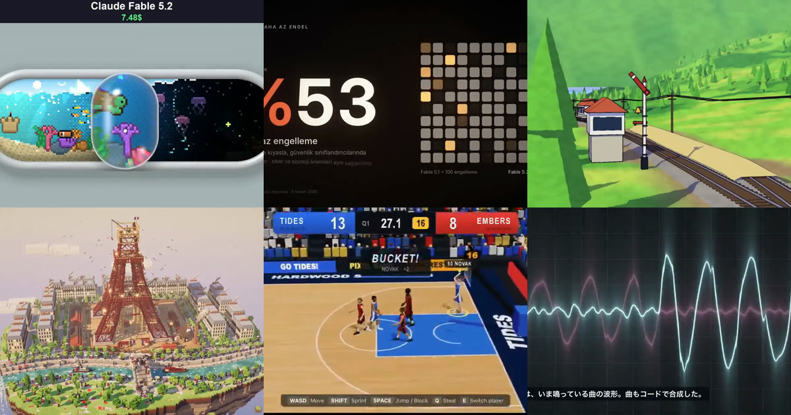

<div align="center">

<a href="https://apiko.app/ko/claude-fable-5-2-video-prompts?utm_source=github&utm_medium=banner&utm_campaign=awesome-claude-fable-5.2-video-prompts"></a>

[](LICENSE)
[](README_ko.md#menu)
[](https://apiko.app/ko/models/claude-fable-5-2?utm_source=github&utm_medium=badge&utm_campaign=awesome-claude-fable-5.2-video-prompts&utm_content=model_try)
[](https://apiko.app/docs/api-manual/text-series/claude?utm_source=github&utm_medium=badge&utm_campaign=awesome-claude-fable-5.2-video-prompts&utm_content=docs)

[](README.md)
[](README_zh-CN.md)
[](README_zh-TW.md)
[](README_ko.md)

</div>

# Awesome Claude Fable 5.2 영상 프롬프트

<a id="introduction"></a>
## 🌟 소개

**Claude Fable 5.2 영상 프롬프트: 실제 프롬프트 22개와 그 결과 영상. WebGL 슬라이더, Three.js 장면부터 Blender 애니메이션, LilyPond 음악까지.**

Claude Fable 5.2 영상 프롬프트를 출시 직후 크리에이터들이 공개한 작품에서 모았습니다. 카드마다 작성자의 원문 프롬프트와 그 결과 영상이 있어 그대로 복사해 비교할 수 있습니다. 결과 영상은 모두 GitHub에서 바로 재생됩니다.

검색과 필터는 [apiko.app/claude-fable-5-2-video-prompts](https://apiko.app/ko/claude-fable-5-2-video-prompts?utm_source=github&utm_medium=readme&utm_campaign=awesome-claude-fable-5.2-video-prompts&utm_content=intro).

> [!NOTE]
> 프롬프트는 작성자가 올린 원문 그대로라 대부분 영어입니다. 제목과 설명은 저희가 썼습니다. 모든 예시에 작성자와 원본 게시물 링크를 달았습니다.

<a id="quick-start"></a>
## 🚀 빠른 시작

**브라우저에서:** 모든 예시에 **APIKO에서 실행** 링크가 있습니다. [apiko.app](https://apiko.app/ko/claude-fable-5-2-video-prompts?utm_source=github&utm_medium=quickstart&utm_campaign=awesome-claude-fable-5.2-video-prompts&utm_content=browser)에서 해당 예시가 열리며, **사용**을 누르면 프롬프트가 Claude Fable 5.2 플레이그라운드에 채워집니다.

**API로:** [APIKO API 키](https://apiko.app/ko/dashboard/apikeys?utm_source=github&utm_medium=quickstart&utm_campaign=awesome-claude-fable-5.2-video-prompts&utm_content=api_key)를 만든 뒤 프롬프트를 Messages API로 보냅니다. Claude가 코드를 돌려주면, 그 코드를 내 컴퓨터에서 실행해 영상을 만듭니다.

```bash
export APIKO_API_KEY="your_key_here"

curl -s https://api.apiko.app/v1/messages \
  -H "Authorization: Bearer $APIKO_API_KEY" \
  -H "anthropic-version: 2023-06-01" \
  -H "Content-Type: application/json" \
  -d '{
  "model": "claude-fable-5-2",
  "max_tokens": 16000,
  "messages": [{
    "role": "user",
    "content": "Write one self-contained index.html that animates a paper boat crossing a lake at sunrise for 10 seconds at 1920x1080, plus the Playwright and FFmpeg commands that render it to boat.mp4."
  }]
}' | python3 -c 'import json,sys; print("".join(b.get("text","") for b in json.load(sys.stdin)["content"]))'
```

엔드포인트: `POST https://api.apiko.app/v1/messages` (프롬프트 전송)

<a id="how-to-write"></a>
## ✍️ Claude Fable 5.2 영상 프롬프트 작성법

Claude Fable 5.2는 영상 파일이 아니라 코드를 씁니다. 코드를 내 컴퓨터에서 렌더링하고 프레임으로 기록합니다. 먼저 방식을 정하고 프롬프트에 적으세요.

- **하나로 완결된 페이지** · `단일 HTML + WebGL 또는 Canvas + Web Audio + "라이브러리 없음"` — 볼륨 슬라이더 카드 두 개는 원시 WebGL2, Web Audio, 픽셀 버퍼만 쓰는 한 페이지를 요구합니다. 브라우저에서 열어 화면을 녹화하면 됩니다.
- **프레임 시계가 있는 Three.js** · `장면 + 길이 + 크기 + fps + window.renderAt(t)` — 복셀 파리 카드는 renderAt(t)를 노출해 정해진 프레임 속도로 모든 프레임을 캡처합니다. 실시간 녹화가 아니라 정확한 영상이 필요할 때 요청하세요.
- **Remotion 또는 HyperFrames** · `프레임워크 + 길이 + 홍보할 내용 + 프로젝트 폴더` — 트레일러 카드는 HyperFrames나 Remotion을 지정하고 프로젝트 안에서 실행해, 모델이 실제 제품을 읽은 뒤 영상을 만들게 합니다.
- **Blender와 LilyPond** · `도구 + 주제 + 렌더 설정, 또는 "코드 블록만"` — 애니메이션 단편은 Blender에서 Python으로 모든 장면을 만들고, 음악 카드는 LilyPond 코드만 요청합니다. 둘 다 코드를 영상으로 바꾸려면 해당 도구를 로컬에 설치해야 합니다.
- **매번 적어야 할 것** · `길이 + 해상도 + fps + effort + 직접 주는 소재` — 길이를 적은 카드는 그 길이를 받았습니다. 노래, 가사, 프로젝트 폴더처럼 어떤 소재를 줄지 적으세요. 여기서 네 카드가 그런 소재에 의존합니다.

**Claude Fable 5.2 예시에서 알 수 있는 것**

- **한 문장으로 충분할 때가 있습니다** UFO, 로고 리빌, "코드만으로" 출시 영상은 한 줄이었습니다. 6,000자 슬라이더 연구처럼 긴 명세는 정확한 결과가 필요할 때 씁니다.
- **크리에이터가 비용을 공개했습니다** 슬라이더 두 개는 $7.48과 $8.43, 직접 만든 출시 영상은 57분 동안 API 가격 기준 약 $21였습니다. 긴 작업은 예산을 잡으세요.
- **큰 작업은 에이전트로 돌립니다** 60초 출시 영상은 Opus 5.5 서브에이전트를 썼고 범죄 게임은 두 시간 넘게 걸렸습니다. 한 번의 API 호출이 아니라 Claude Code 같은 에이전트에서 돌리세요.
- **effort가 영향을 줍니다** 음악 카드는 Extra High, 마법사 영상은 high, 트레일러는 medium이었습니다. Fable 5.2는 모든 요청에서 사고하며 기본값은 high입니다.
- **Opus 5.5도 여전히 가깝습니다** 두 크리에이터가 같은 프롬프트를 두 모델에서 돌렸고, 한 명은 Opus 5.5 결과를 더 좋아했습니다. 모델을 바꾸기 전에 내 아이디어로 비교해 보세요.

<a id="menu"></a>
## 📑 목차

- [✨ 모션 그래픽](#motion-graphics) (6)
  - [두 문장으로 만든 Opus 5.5 작별 쇼릴](#motion-graphics-01)
  - [은하·이중나선을 거쳐 이름이 되는 파티클 글자](#motion-graphics-02)
  - [바닷속 세계로 내려가는 볼륨 슬라이더](#motion-graphics-03)
  - [밤에서 아침으로 넘어가는 아늑한 방 스위치](#motion-graphics-04)
  - [크롬 금속 질감의 3D 로고 리빌](#motion-graphics-05)
  - [한 줄로 만든 15초 모션 디자이너 쇼릴](#motion-graphics-06)
- [🚀 출시와 홍보](#product-launch) (4)
  - [Opus 5.5 서브에이전트로 만든 60초 출시 영상](#product-launch-01)
  - ["네 출시 영상을 직접 만들어. 코드만으로."](#product-launch-02)
  - [HyperFrames로 만든 강의 소셜 트레일러](#product-launch-03)
  - [프롬프트 하나로 만든 키노트풍 지식 사이트 홍보 영상](#product-launch-04)
- [🎞️ 단편 영상](#short-film) (4)
  - [로봇으로 변신하는 증기기관차 2D 애니메이션](#short-film-01)
  - [51구역에 내려와 사람들에게 인사하는 UFO](#short-film-02)
  - [Fable 5.2를 만들어 공개하는 작은 마법사](#short-film-03)
  - [코드만으로 만든 검치호랑이의 사냥](#short-film-04)
- [• 3D 장면](#3d-scenes) (2)
  - [Blender로 만든 고대 예루살렘 몰입형 3D 모델](#3d-scenes-01)
  - [프레임 단위로 렌더링한 1888년 부유 복셀 파리](#3d-scenes-02)
- [• 게임](#games) (2)
  - [한 번에 만든 Three.js 3D 농구 게임](#games-01)
  - [80년대 마이애미풍 도시의 오픈월드 게임](#games-02)
- [• 음악](#music) (4)
  - [LilyPond로 쓴 G단조 바흐풍 코랄](#music-01)
  - [노래와 가사로 만든 일본어 가사 모션 영상](#music-02)
  - [한 점에서 세계로: 코드로 합성한 음악의 셰이더 영상](#music-03)
  - [LilyPond로 쓴 바흐풍 오르간 푸가 전곡](#music-04)
- [❓ 자주 묻는 질문](#faq)
- [🔗 관련 링크](#related)

<a id="motion-graphics"></a>
## ✨ 모션 그래픽

> HTML, WebGL, 셰이더로 그린 쇼릴, 로고 리빌, UI 스위치입니다. · 6개

<a id="motion-graphics-01"></a>
### 1. 두 문장으로 만든 Opus 5.5 작별 쇼릴

작성자 [@kaif9998](https://x.com/kaif9998) · 15초 · 16:9 · **[▶ APIKO에서 실행](https://apiko.app/ko/claude-fable-5-2-video-prompts?utm_source=github&utm_medium=case&utm_campaign=awesome-claude-fable-5.2-video-prompts&utm_content=motion-graphics-01#motion-graphics-01)** · [원본 게시물](https://x.com/kaif9998/status/2119903824848761287)

Claude Code에서 15초 작별 영상을 요청한 뒤 "쇼릴처럼 만들어 줘"를 덧붙입니다.

https://github.com/user-attachments/assets/9e5b1c2c-c8a4-42e2-8e4a-b09d24ed1cc7

**프롬프트:**

```text
Claude Code , two prompts:

1. "make a 15 second animated video that says final goodbye to Opus 5.5 as Fable 5.2 is here and I switched to it"
2. "make the video like it's your showreel"
```

<a id="motion-graphics-02"></a>
### 2. 은하·이중나선을 거쳐 이름이 되는 파티클 글자

작성자 [@ici_dab](https://x.com/ici_dab) · 68초 · 1:1 · **[▶ APIKO에서 실행](https://apiko.app/ko/claude-fable-5-2-video-prompts?utm_source=github&utm_medium=case&utm_campaign=awesome-claude-fable-5.2-video-prompts&utm_content=motion-graphics-02#motion-graphics-02)** · [원본 게시물](https://x.com/ici_dab/status/2119901910237098351)

"가장 인상적인 걸 만들어 달라"는 열린 요청입니다. 음악이 붙은 인터랙티브 파티클 작품이 나왔습니다.

https://github.com/user-attachments/assets/87dcae6e-5db0-493b-af51-7728f885e228

**프롬프트:**

```text
the prompt: "I need you to create the most impressive thing I can share with people when you launch. It needs to be embeddable in a post and i can preface it however you like. it needs to have a visceral impact on people to show what you can do and the range of capabilities. It should grab them quickly. Be amazingly clever about this."
```

<a id="motion-graphics-03"></a>
### 3. 바닷속 세계로 내려가는 볼륨 슬라이더

작성자 [@N1njaCodex](https://x.com/N1njaCodex) · 11초 · 16:9 · **[▶ APIKO에서 실행](https://apiko.app/ko/claude-fable-5-2-video-prompts?utm_source=github&utm_medium=case&utm_campaign=awesome-claude-fable-5.2-video-prompts&utm_content=motion-graphics-03#motion-graphics-03)** · [원본 게시물](https://x.com/N1njaCodex/status/2119883560937001387)

라이브러리 없이 WebGL2와 Web Audio만 쓰는 스위치의 긴 명세입니다. 작성자는 비용이 $7.48였다고 밝혔습니다.

https://github.com/user-attachments/assets/881af4cb-a87b-4dc0-a277-595d823729f8

**프롬프트:**

```text
Make "Deep Dive Switch", No. 063 in a series of web material studies: a depth switch that goes from light to dark, from the sea's surface to the floor of the abyss. Build it as one self-contained page with no libraries: raw WebGL2, Web Audio and a 2D pixel buffer.

PAGE
- Editorial layout: a small kicker "Material Studies / No. 063 · WebGL + Web Audio", an italic serif title "Deep Dive Switch.", and a one-line caption.
- The switch sits centred and large. Below it go three readouts (Depth, Zone, Music), a hint line and a "Sound on/off" button.
- The whole page's colours (background, text, lines) follow the depth: pale aqua at the surface, near-black blue in the abyss.
- It must work at phone width.

THE SWITCH
- A pill-shaped switch in a moulded bezel: white glossy plastic at the surface, deep navy in the abyss.
  - A soft drop shadow falls on the page and fades to nothing before the canvas edge.
  - A slight inner shadow runs along the top of the track.
- Inside it is a 176×50 pixel-art cross-section of the sea.
  - Redraw it every frame on the CPU and show it with nearest sampling, never smoothed.
  - Use whole device pixels per scene pixel where there is room.
- The knob is a glass bathysphere: a vertical capsule of clear glass, a little taller than the track, drawn in a single full-canvas WebGL2 fragment shader.
  - It magnifies what is under it (about 1.28×) and bends it.
  - At its rim it splits R, G and B. A darker refraction band sits inside a bright edge, with a Fresnel tint and a faint aqua cast.
  - Two highlights: a long soft streak at the upper left and a small dot at the lower right.
  - Light gathers toward its foot, and it casts a soft shadow on the scene.
- Motion:
  - It follows the finger on a spring, lagging a little.
  - It stretches sideways with speed and squashes vertically to keep its volume.
  - It wobbles on a damped spring driven by its acceleration.
- Controls:
  - Drag the knob, or drag anywhere on the track.
  - Tap to send it to the other end; it travels there on its spring.
  - Arrow keys, Home/End and Space/Enter also work.
  - The switch has role="slider" with ARIA values.

THE SEA (left = shallow, right = deep; an original palette)
- Sprites are filled shapes stamped with an automatic 1-px outline and a light top / dark bottom.
- The sea floor, left to right:
  - a sandy beach with a sandcastle;
  - a reef plateau with rocks;
  - a drop-off into rocky deep water;
  - the abyssal floor rising again at the far right.
- Up top on the left is sky with a sun, two flapping gulls and a little red sailboat bobbing on animated waves with a foam line.
  - The surface is level over the shallows, then rises out of the picture toward the deep, so the view seems to sink.
- The shallows:
  - turquoise water with swaying slanted god rays and moving caustics on the sand;
  - branching corals in pink, orange and violet, brain corals, swaying sea grass;
  - an anemone with a little orange-and-white fish darting about it;
  - a sea turtle gliding back and forth, paddling;
  - a school of yellow fish circling over the reef that scatters away from the knob.
- The twilight zone:
  - the water darkens to deep blue;
  - three translucent jellyfish, pink and violet, pulse and trail wavy tentacles; they glow softly and pulse faster when the knob comes near;
  - every half minute a faint whale silhouette swims past in the background.
- The midnight zone:
  - a long swaying chain of glowing cyan-and-green beads (a siphonophore);
  - small dark lanternfish with blinking light spots;
  - marine snow drifting down.
- The abyssal floor:
  - a hydrothermal vent breathing bubbles;
  - an anglerfish with a rod and a glowing lure;
  - a treasure chest.

LIGHT AND THE DIVE
- Daylight falls off with depth and dims a little toward the floor. It is quantised and Bayer-dithered so the gradient steps like pixel art.
- Below the shallows the bathysphere's searchlight comes on: a stepped, dithered pool of light around the knob, with a blue haze scattered in the water.
- Inside the lens everything is shown lit.
- Behind the knob trail rising bubbles and, in the dark, sparks of blue bioluminescence.
- Glowing crescent echoes trail behind it: pale aqua in the shallows, cyan in the deep.
- The lure lights its own little pool.
- As the knob nears, the anglerfish turns and opens its toothy mouth wide, and its lure blazes.
- At the very bottom the chest lid swings open on glowing gold, and gold glints fly up from it.

SOUND — all synthesised live with Web Audio, original music
- 84 BPM, a four-bar loop in D minor (Dm7 · B♭maj7 · Gm7 · A7sus4), on one lookahead-scheduled clock with a little swing.
- Layers fade in and out with depth:
  0. The surface: waves (filtered noise swelling slowly) and gull cries. The moment you go under, a splash, and the waves drop to a dull underwater roar.
  1. The reef: a kalimba ostinato (sine with bright, quickly fading overtones, in a long reverb), with bubbles popping on the off-beats.
  2. A soft dub beat: a round kick, rim clicks into a dotted echo, a swung shaker, a deep bass.
  3. The twilight: slow detuned pads, a whale singing now and then (a gliding, vibrato tone through a formant filter), then sonar pings ringing in the echo.
  4. The abyss: a breathing sub drone, a slow lub-dub heartbeat, and glassy arpeggios of high pentatonic notes ringing in the echo.
- The music sits behind a gentle low-pass that closes a little with depth, about 5 dB under the switch's own sounds.
- Switch sounds:
  - a bubble bloop when grabbed, a plop when released;
  - a water swish and bubble pops that grow with drag speed;
  - a splash crossing the surface either way;
  - a glass chime past each jellyfish;
  - the angler's deep gulp;
  - a fanfare when the chest opens: a rising kalimba arpeggio, a low boom and a shimmer.
- Audio starts on the first touch; a Sound on/off button.

READOUTS
- Depth, 0 → 6,000 m, mapped to the zones.
- Zone: Surface / Sunlit / Twilight / Midnight / Abyss.
- Music: Waves / Kalimba / Reef dub / Whale song / Sonar / Abyss.
```

<a id="motion-graphics-04"></a>
### 4. 밤에서 아침으로 넘어가는 아늑한 방 스위치

작성자 [@vib3coded](https://x.com/vib3coded) · 13초 · 16:9 · **[▶ APIKO에서 실행](https://apiko.app/ko/claude-fable-5-2-video-prompts?utm_source=github&utm_medium=case&utm_campaign=awesome-claude-fable-5.2-video-prompts&utm_content=motion-graphics-04#motion-graphics-04)** · [원본 게시물](https://x.com/vib3coded/status/2119876781700505627)

같은 "소재 연구" 형식으로, WebGL2와 Web Audio만 쓴 단일 페이지입니다. 작성자는 10분, $8.43이 들었다고 밝혔습니다.

https://github.com/user-attachments/assets/43693a77-956f-4518-87de-c64e9c99b327

**프롬프트:**

```text
Make "Daybreak Switch", No. 062 in a series of web material studies: a night-to-morning toggle in its own original style, as a single self-contained page (no libraries; raw WebGL2 + Web Audio + a 2D pixel buffer). Editorial layout: a small "Material Studies / No. 062 · WebGL + Web Audio" kicker, an italic serif title "Daybreak Switch.", a one-line caption; the switch centred and large; below it readouts (Clock, Light, Music), a hint line and a "Sound on/off" button. The whole page's colours (background, text, lines) follow the switch from a dark dusk-indigo at night to a pale lavender-grey by day. Works at phone width.

THE SWITCH
- A pill-shaped switch in a moulded bezel: white glossy plastic by day, graphite by night. A soft drop shadow falls on the page and fades to nothing before the canvas edge, with a slight inner shadow along the top of the track.
- Inside, a 176×50 pixel-art room, redrawn every frame on the CPU and shown with nearest sampling, never smoothed. Whole device pixels per scene pixel where there is room.
- The knob is a vertical capsule of clear jelly glass, a little taller than the track, drawn in one full-canvas WebGL2 fragment shader:
  - it magnifies (~1.28×) and bends the pixels under it;
  - it splits R/G/B at its rim, with a darker refraction band, a bright edge and a Fresnel tint;
  - two highlights: a long soft streak at the upper left and a small dot at the lower right;
  - light focused toward its foot, and a soft shadow on the room.
- The knob lags the finger on a spring, stretches horizontally with speed (squashing vertically to keep its volume), and wobbles on a damped spring fed by its acceleration.
- Inside the knob the room is always shown fully lit: the glass carries the morning.
- Controls: drag the knob or drag anywhere on the track; tap to toggle to the other end (it travels there on its spring); arrow keys, Home/End, Space/Enter; role="slider" with aria values.

THE ROOM (original, cosy palette)
Built from filled shapes stamped with an automatic 1-px outline and a light top / dark bottom, so every object reads as a pixel sprite:
- butter-yellow diamond wallpaper, teal wainscot, plank floor, a coral/cream/teal striped rug;
- a big window with curtains over a town of roofs;
- a shelf of coloured jelly jars and books, a potted plant;
- a brass floor lamp with a mint shade;
- a red boombox on a wooden cabinet, a framed picture of a little jelly shark, a round wall clock, a blue panelled door;
- a string of coloured bulbs sagging across the ceiling;
- a purple pet bed under the window.

LIGHT AND THE MORNING
- The knob drags the dawn across the room: left of it is day, right of it still night (indigo ambient). The edge dissolves in a 4×4 Bayer dither, with a warm dawn band just behind the knob.
- The window sky runs from night (navy, twinkling stars, a crescent moon, lit town windows) through dawn (violet to peach, the sun coming up) to day (blue, sun high, clouds drifting).
- Moonlight shafts through the window at night, warm sun shafts by day.
- The lamp clicks on early and casts a banded warm pool.
- Each ceiling bulb lights as the knob passes it, with a coloured dithered glow.
- Disco spots sweep the room at the party.
- The wall clock runs from 02:00 to 10:00.

THE STORY, BY POSITION
- An orange tabby cat:
  - asleep, curled in its bed, breathing, with z's rising;
  - awake, lying with its head up and blinking;
  - sitting up;
  - standing and walking out onto the rug;
  - at the end dancing on its hind legs to the beat, in sunglasses, with pink ghost trails.
- The plant sways and the boombox speakers thump with the beat; music notes float up from the boombox.
- A disco ball comes down from the ceiling; confetti sparkles fall.
- Glowing crescent echoes (coral to pink) trail behind the moving knob.
- Near the end (from about 08:24 on the clock) a puppy waits outside: warm light shows under the door with the shadows of its shifting paws, and it knocks. On each knock the door jolts 2 px, arcs of sound spring off it, and a "!" pops up over the cat; the knocking repeats every ~2.8 s until it's let in. At the very end the door swings open on a warm orange hallway and a white puppy with brown ears comes in, bobbing to the beat.

SOUND — all synthesised live with Web Audio, original music
- 100 BPM, a four-bar loop in F (Fmaj7 · Am7 · Dm7 · B♭maj7), on one lookahead-scheduled clock with a little swing.
- Layers fade in by the knob's position:
  0. Night: crickets (AM-chirped sine trains) and soft wind.
  1. A music box arpeggiating the chords (bell partials, short room reverb).
  2. A lo-fi beat (kick, noise-and-tone snare, hats) and a round bass.
  3. Warm detuned pads and a square-wave tune with vibrato.
  4. The party: four on the floor, claps, open hats, sub bass, the rest of the mix pumping under the kick.
- The music sits behind a low-pass that opens with the dawn, and ~5 dB under the switch's own sounds.
- Switch sounds:
  - a glass tink plus a jelly blop when grabbed, a plop when released;
  - a band-passed noise rub following the drag speed;
  - a pentatonic pluck for every bulb lit (a glissando when you sweep across), softer and lower when one goes out;
  - the lamp's double click and a cat's "mrrp" (formant-filtered saw) when it wakes;
  - a riser and crash into the party, and a record-brake when you drag back out of the beat;
  - the puppy's yip when it comes in.
- The knock, like a real heavy door knock: three hits 0.25 s apart, panned toward the door. Each hit is a knuckle click (band-passed noise) over a deep thump that sags from ~98 to ~60 Hz over a quarter second, with quicker overtones (190→128 Hz, 410 Hz) and soft saturation so small speakers hear it. The music ducks to ~45% under each hit, and the knocks peak at 3–4× the music's level.
- Audio starts on the first touch; a Sound on/off button.
- Readouts: Clock (02:00–10:00), Light (Night / First light / Sunrise / Morning / Party), Music (Crickets / Music box / Beat / Band / Party).
```

<a id="motion-graphics-05"></a>
### 5. 크롬 금속 질감의 3D 로고 리빌

작성자 [@hello_amani](https://x.com/hello_amani) · 36초 · 1:1 · **[▶ APIKO에서 실행](https://apiko.app/ko/claude-fable-5-2-video-prompts?utm_source=github&utm_medium=case&utm_campaign=awesome-claude-fable-5.2-video-prompts&utm_content=motion-graphics-05#motion-graphics-05)** · [원본 게시물](https://x.com/hello_amani/status/2119873980786237842)

"크롬 금속과 그리드로 내 로고를 3D로 보여 주고 여러 번 다듬어 줘"라는 한 문장입니다.

https://github.com/user-attachments/assets/a73ee82d-e624-4214-822d-db0306296688

**프롬프트:**

```text
the prompt was: make my logo reveal in 3D with chromatic metal and grids
and bunch of iteration
```

<a id="motion-graphics-06"></a>
### 6. 한 줄로 만든 15초 모션 디자이너 쇼릴

작성자 [@himanshutwtxs](https://x.com/himanshutwtxs) · 15초 · 16:9 · **[▶ APIKO에서 실행](https://apiko.app/ko/claude-fable-5-2-video-prompts?utm_source=github&utm_medium=case&utm_campaign=awesome-claude-fable-5.2-video-prompts&utm_content=motion-graphics-06#motion-graphics-06)** · [원본 게시물](https://x.com/himanshutwtxs/status/2120017106804900304)

많은 사람이 Opus 5.5에서 돌린 같은 문장을 Fable 5.2로 돌렸습니다. 이징, 타이포, 깊이, 타이밍이 한 편에 담깁니다.

https://github.com/user-attachments/assets/e708f162-826c-4b84-86d5-3ca6a64080d3

**프롬프트:**

```text
make a dynamic 15-second motion graphics video that shows what an incredible motion designer you are, like it's your showreel for a résumé. go all out
```

<a id="product-launch"></a>
## 🚀 출시와 홍보

> "코드만으로"라는 한 줄부터 프로젝트 폴더를 먼저 조사하게 하는 방식까지, 출시 영상과 트레일러입니다. · 4개

<a id="product-launch-01"></a>
### 7. Opus 5.5 서브에이전트로 만든 60초 출시 영상

작성자 [@grafikcem](https://x.com/grafikcem) · 60초 · 16:9 · **[▶ APIKO에서 실행](https://apiko.app/ko/claude-fable-5-2-video-prompts?utm_source=github&utm_medium=case&utm_campaign=awesome-claude-fable-5.2-video-prompts&utm_content=product-launch-01#product-launch-01)** · [원본 게시물](https://x.com/grafikcem/status/2119910525064937806)

튀르키예어 프롬프트로, 출시 당일 Opus 5.5 서브에이전트를 써서 Fable 5.2의 60초 애니메이션 영상을 만들게 합니다.

https://github.com/user-attachments/assets/5c70cca9-79e2-41f0-85a5-cc7a75118cd4

**프롬프트:**

```text
Bugün duyurulmana özel Fable 5.2 modeli için opus 5.5 subagentları kullanarak kendine 60 saniyelik bir tanıtım animasyon filmi hazırla.
```

<a id="product-launch-02"></a>
### 8. "네 출시 영상을 직접 만들어. 코드만으로."

작성자 [@furkancavlakcom](https://x.com/furkancavlakcom) · 74초 · 16:9 · **[▶ APIKO에서 실행](https://apiko.app/ko/claude-fable-5-2-video-prompts?utm_source=github&utm_medium=case&utm_campaign=awesome-claude-fable-5.2-video-prompts&utm_content=product-launch-02#product-launch-02)** · [원본 게시물](https://x.com/furkancavlakcom/status/2119896886345695521)

튀르키예어 한 문장입니다. 작성자는 57분, API 가격 기준 약 $21, Python 1,702줄, 2,220프레임이 들었고 음악도 합성했다고 밝혔습니다.

https://github.com/user-attachments/assets/73630cf7-74c1-40a2-8661-01130ec49748

**프롬프트:**

```text
Kendi lansman videonu yap. Sadece kodla.
```

<a id="product-launch-03"></a>
### 9. HyperFrames로 만든 강의 소셜 트레일러

작성자 [@midudev](https://x.com/midudev) · 32초 · 9:16 · **[▶ APIKO에서 실행](https://apiko.app/ko/claude-fable-5-2-video-prompts?utm_source=github&utm_medium=case&utm_campaign=awesome-claude-fable-5.2-video-prompts&utm_content=product-launch-03#product-launch-03)** · [원본 게시물](https://x.com/midudev/status/2119876297304203273)

작성자의 프로젝트 안에서 돌린 스페인어 프롬프트입니다. 소리와 강한 애니메이션을 요청했고 medium 단계로 약 10분 걸렸습니다.

https://github.com/user-attachments/assets/8066c1f5-8a96-4b12-8810-a3c7dd64175d

**프롬프트:**

```text
El prompt:  Crea un trailer en video animado para compartir en redes sociales de este proyecto. Quiero que lo vendas de forma espectacular, que tenga sonido y animaciones brutales. Usa hyperframes.

Esfuerzo medio.
```

<a id="product-launch-04"></a>
### 10. 프롬프트 하나로 만든 키노트풍 지식 사이트 홍보 영상

작성자 [@czzzzzzJ_](https://x.com/czzzzzzJ_) · 298초 · 16:9 · **[▶ APIKO에서 실행](https://apiko.app/ko/claude-fable-5-2-video-prompts?utm_source=github&utm_medium=case&utm_campaign=awesome-claude-fable-5.2-video-prompts&utm_content=product-launch-04#product-launch-04)** · [원본 게시물](https://x.com/czzzzzzJ_/status/2120023093464682817)

사이트 프로젝트 폴더에서 돌린 중국어 프롬프트입니다. 사업을 조사하고 질문은 한 번만 한 뒤 애플 키노트 느낌의 영상을 바로 만듭니다.

https://github.com/user-attachments/assets/591923c2-ce88-4a12-a29b-0d834d5d0200

**프롬프트:**

```text
你现在在我的知识站项目目录下，完整地调研我知识站上所有的业务、提供的内容，以及我的商业模式。使用 opuscar这个库帮我生成我的知识站宣传视频，整体风格我希望是像苹果的发布会那种风格质感。素材可以自行搜索和获取截屏。关于我不了解的内容，DOC 文件夹下有我的个人介绍。在整个宣传片制作前，你有一次向我提问的机会，收集我的想法，然后我要求你直接成片。
```

<a id="short-film"></a>
## 🎞️ 단편 영상

> Blender 애니메이션, Three.js UFO, 캐릭터 애니메이션, 동물 사냥처럼 코드로 만든 이야기입니다. · 4개

<a id="short-film-01"></a>
### 11. 로봇으로 변신하는 증기기관차 2D 애니메이션

작성자 [@0kncn](https://x.com/0kncn) · 90초 · 16:9 · **[▶ APIKO에서 실행](https://apiko.app/ko/claude-fable-5-2-video-prompts?utm_source=github&utm_medium=case&utm_campaign=awesome-claude-fable-5.2-video-prompts&utm_content=short-film-01#short-film-01)** · [원본 게시물](https://x.com/0kncn/status/2119901782482543073)

긴 명세입니다. Blender에서 Python으로 모두 만들고 Eevee로 렌더링한 뒤 프레임마다 선과 색을 입히고 음악도 합성합니다. 90초.

https://github.com/user-attachments/assets/0190d27a-1663-40f4-bf7a-8bef95c16d03

**프롬프트:**

```text
Create a 2D anime short. It must look completely like real Japanese anime, as if it were taken directly from a finished theatrical anime film. This is traditional-looking, hand-drawn 2D anime, not a 3D animation, a moving illustration, or a stylized web graphic.

Build everything in Blender from Python, render it in Eevee, then ink and paint every frame in a second pass. Deliver one 1920x1080, 24 fps MP4 with a synthesized soundtrack. Use any tools, libraries, references, guides, literally anything, as long as the final result looks 100% like hand-drawn 2D anime.

Use theatrical anime as the art style reference for the design, line work, painted backgrounds, color and atmosphere. The film is 90 seconds long (2160 frames), in 42 shots. Its hero is a steam locomotive that transforms into a robot. No people appear in the film.

HERO
No. 9, a 1940s 2-8-2 freight locomotive with a four-axle tender, 23 m long, asleep for decades in a mountain engine shed: matte black boiler with rust runs, faded red wheel centres and buffer beam, brass number plate "9", one large headlamp, two amber marker lamps, moss on the running boards, ivy through the cab windows, and a stork's nest on the cab roof. As a robot it stands 21 m tall with its shoulders at 17 m. It is an original design, not a character from any existing series. It moves on twos, slow and heavy. Its wheels never slip and its feet never slide.

TRANSFORM
One transformation, at full speed, 120 frames, in five stages of 24 frames. Every part is rigid: nothing stretches, nothing vanishes, nothing appears. Each part travels on a hinge or a slide you can see.
1. Legs: the tender uncouples, splits lengthwise and swings down; its two bogies lock as feet, the coal stays in bunkers on the calves.
2. Hips: the cab drops and widens into the pelvis; the trailing truck folds onto the lower back.
3. Torso: the boiler tilts upright, firebox at the waist, smokebox at the top; the chimney and steam dome end on the upper back and keep venting.
4. Arms: the running boards swing out with the cylinders as shoulders, the piston and connecting rods as forearms, and hands with three fingers and a thumb unfolding from the valve gear; the front driving wheels ride up as shoulder discs, the rear ones fold to hips and knees.
5. Head: the smokebox door hinges forward as the chest plate with the headlamp at its centre; a riveted helmet rises from the smokebox with one dark visor slit and the two marker lamps as amber eyes; the cowcatcher folds up as a collar.
The cab roof panel rides up to the right shoulder and carries the stork's nest, never tilted more than 10 degrees.
Stages 1-3 happen on the rails, with the first strides landing on the ballast either side of the track. Stages 4-5 happen in the air.

WORLD
A single-track mountain railway at real scale. At the top, an ore mine with a loading bunker and a rake of twelve four-wheel hopper wagons. The line descends through larch forest and a short rock tunnel to a viaduct: seven 18 m steel girder spans on stone piers, 126 m long, the deck 17 m above a turquoise meltwater river 3 m deep. Beyond it, a small station: a stone engine shed, a water tower, a semaphore signal with an alarm bell, a signal box, a siding ending in a sand drag. Snow peaks behind, a cliff face above the viaduct, telegraph poles along the whole line.

STORY
A clear spring morning in the valley. Meltwater loosens the cliff: a rockfall hits the middle pier of the viaduct, the pier collapses into the river and the two girders it carried sag into a V, held only by the rails. Up at the mine the shock snaps a coupling and the twelve loaded wagons start to roll downhill, unmanned. At the station the semaphore drops to danger and the bell rings. In the dark shed the firebox glows, the pressure needle climbs, the headlamp lights; the stork flies up. No. 9 bursts through the shed doors tearing ivy and rust, and charges up the grade with the wagons coming down the other side. On the approach it transforms at full speed, leaps from the abutment, lands crouched in the river, wades to the fallen pier, and lifts the sagging joint onto its shoulders and raised hands. The wagons hit the viaduct: it sinks 0.3 m as each one passes over and holds. The rake runs through the station into the sand drag and stops. No. 9 does not come back out. It locks its knees and stays as the new pier. The steam thins, the stork returns to its nest, the visor dims.

LIGHT
High-key anime light, never murky: a morning sun from the south-east, a saturated cobalt sky, white cumulus with lavender shadows, snow peaks with blue shadows, fresh green larch, a turquoise river with drawn white water. Light only changes with a cause you can see: rock dust dims the gorge for 3 seconds, steam whites out a frame, the firebox throws orange onto the shed walls. Cel light with hard shadows, gouache backgrounds, ink lines on every machine, rail and building, effects drawn on twos: steam as inked rolling shapes with a flat shadow tone, water as inked sheets with foam crowns, dust as drawn clouds, never particle mush.

SOUND
A synthesized orchestra on a 144 bpm grid: one beat is 10 frames, and every cut lands on a multiple of 5 frames. A hopeful theme on clarinet and horn, the collapse in E minor, a 12/8 chase with the exhaust chuff as percussion at four beats per wheel revolution, a heavy 3/4 for the hold with one low drum per wagon. 16 hits land exactly on the picture: the rockfall, the pier, the coupling, the signal arm, the shed doors, each transformation lock, the landing, the lift, the first and last wagon. The steam whistle is heard twice: once on waking, once on the hold.

FORMAT
Write the film as a Python story clock: one state per frame for every pose, camera, wheel angle, rod position, transformation part, wagon, effect and sound cue.

CHECKS
Before the final render a script tests every frame on the real meshes: no part of No. 9 goes through another part, in either form or at any frame of the transformation; the total volume of its parts is the same in both forms; every wheel on a rail turns exactly as far as it travels; planted feet do not move; No. 9 never goes through the track, the shed, the viaduct or the riverbed; the wagons stay on the rails and never touch each other except at the couplings; the camera never enters a mesh, the cliff or the water; nothing jumps between frames.
```

<a id="short-film-02"></a>
### 12. 51구역에 내려와 사람들에게 인사하는 UFO

작성자 [@danteeonsol](https://x.com/danteeonsol) · 30초 · 16:9 · **[▶ APIKO에서 실행](https://apiko.app/ko/claude-fable-5-2-video-prompts?utm_source=github&utm_medium=case&utm_campaign=awesome-claude-fable-5.2-video-prompts&utm_content=short-film-02#short-film-02)** · [원본 게시물](https://x.com/danteeonsol/status/2119887623070077213)

한 문장입니다. 작성자는 외부 모델, 텍스처, 스톡 오디오 없이 three.js와 Remotion으로 모두 만들었다고 밝혔습니다.

https://github.com/user-attachments/assets/c7cfb08e-732f-49b6-a675-aaf2b634ff31

**프롬프트:**

```text
make me a 30 second video of a UFO visiting Area 51 and greeting humans, ultra detailed, cinematic lighting
```

<a id="short-film-03"></a>
### 13. Fable 5.2를 만들어 공개하는 작은 마법사

작성자 [@other__reality](https://x.com/other__reality) · 26초 · 16:9 · **[▶ APIKO에서 실행](https://apiko.app/ko/claude-fable-5-2-video-prompts?utm_source=github&utm_medium=case&utm_campaign=awesome-claude-fable-5.2-video-prompts&utm_content=short-film-03#short-film-03)** · [원본 게시물](https://x.com/other__reality/status/2119885430627913784)

high 단계로 작성자가 이미 가진 애니메이션 기반 위에서 돌렸으므로, 따라 하려면 비슷한 시작 프로젝트가 필요합니다.

https://github.com/user-attachments/assets/92969c9a-3481-4f59-a2e6-e58f096fa4d4

**프롬프트:**

```text
Create an animated video of clawd creating and releasing Claude Fable 5.2
```

<a id="short-film-04"></a>
### 14. 코드만으로 만든 검치호랑이의 사냥

작성자 [@wshuyi](https://x.com/wshuyi) · 28초 · 16:9 · **[▶ APIKO에서 실행](https://apiko.app/ko/claude-fable-5-2-video-prompts?utm_source=github&utm_medium=case&utm_campaign=awesome-claude-fable-5.2-video-prompts&utm_content=short-film-04#short-film-04)** · [원본 게시물](https://x.com/wshuyi/status/2120014892040417720)

중국어 프롬프트로, 스킬 없이 순수 코드 애니메이션을 만들고 효과음도 직접 코드로 생성하며 30초 이내로 하게 합니다.

https://github.com/user-attachments/assets/768c8130-3fc8-40c6-843d-e396e450a89d

**프롬프트:**

```text
不使用任何技能，做一段纯编程形成的动画视频：剑齿虎的捕猎。不用配音，你自己编程生成音效，时长控制在 30 秒以内
```

<a id="3d-scenes"></a>
## • 3D 장면

> Blender나 Three.js로 장소 전체를 만들고 카메라로 둘러봅니다. · 2개

<a id="3d-scenes-01"></a>
### 15. Blender로 만든 고대 예루살렘 몰입형 3D 모델

작성자 [@kplikethebird](https://x.com/kplikethebird) · 30초 · 16:9 · **[▶ APIKO에서 실행](https://apiko.app/ko/claude-fable-5-2-video-prompts?utm_source=github&utm_medium=case&utm_campaign=awesome-claude-fable-5.2-video-prompts&utm_content=3d-scenes-01#3d-scenes-01)** · [원본 게시물](https://x.com/kplikethebird/status/2119900775727902732)

역사 속 한 주의 도시를 고증대로 재현해 달라는 한 문장입니다. 영상은 성전, 정원, 궁전을 둘러봅니다.

https://github.com/user-attachments/assets/64ace52b-eec2-415d-a55a-5ad13bff8c78

**프롬프트:**

```text
Build an immersive, historically accurate 3D model of Jerusalem during the week of Jesus's final visit using Blender.
```

<a id="3d-scenes-02"></a>
### 16. 프레임 단위로 렌더링한 1888년 부유 복셀 파리

작성자 [@RezAIT00](https://x.com/RezAIT00) · 14초 · 16:9 · **[▶ APIKO에서 실행](https://apiko.app/ko/claude-fable-5-2-video-prompts?utm_source=github&utm_medium=case&utm_campaign=awesome-claude-fable-5.2-video-prompts&utm_content=3d-scenes-02#3d-scenes-02)** · [원본 게시물](https://x.com/RezAIT00/status/2119894257519767656)

renderAt(t)를 노출해 모든 프레임을 캡처하는 자세한 three.js 명세로, 섬 위 파리에서 에펠탑이 지어지는 장면입니다.

https://github.com/user-attachments/assets/af1de0bb-80d3-4868-923a-63470c7325a5

**프롬프트:**

```text
Build a single self-contained three.js HTML page that renders a 14-second animation (1280x720, 30fps, deterministic: expose window.renderAt(t) so every frame can be captured).  Scene: a floating voxel diorama island - Paris, 1888, the Eiffel Tower under construction. Everything is already moving on frame 1.  Island: - floating chunk with layered rock underside, the Seine curving across the front with stone quays and an arched bridge - Champ de Mars: dirt work yard, stacks of iron girders, wooden sheds, a steam engine with a smoking chimney - around it: rows of Haussmann buildings with cream walls, grey zinc roofs, chimneys, tiny trees along the boulevards  The tower (the hero): - dark reddish-brown wrought iron lattice made of thin voxel beams with real X-bracing, not solid blocks - four curved legs and the first platform finished, the second level half built, the top section only a skeleton - wooden scaffolding towers under the legs, small creeper cranes on the structure lifting girders on chains - glowing orange rivet sparks where workers hammer, small puffs of steam  Life (hundreds of tiny voxel people, ~3 voxels tall): - riveting teams on every level with hammers swinging, workers walking along beams - girders hoisted by cranes swinging slowly into place - horse-drawn carts carrying iron across the yard, crowds of onlookers in 1880s clothes with top hats and parasols - a riverboat with a smoking funnel moving along the Seine, carriages crossing the bridge, pigeons circling the tower  Camera and look: - wide view of the whole island, slow orbit (~25 degrees) with a gentle push-in toward the tower - warm late-afternoon sun, soft shadows, ambient occlusion, light haze, rounded voxels, ACES tone mapping, soft bloom on sparks

Full credits go to @semichenkko for this prompt
```

<a id="games"></a>
## • 게임

> 프롬프트 하나로 만든 Three.js 게임이며, 영상은 플레이 녹화입니다. · 2개

<a id="games-01"></a>
### 17. 한 번에 만든 Three.js 3D 농구 게임

작성자 [@joshvlc](https://x.com/joshvlc) · 19초 · 21:9 · **[▶ APIKO에서 실행](https://apiko.app/ko/claude-fable-5-2-video-prompts?utm_source=github&utm_medium=case&utm_campaign=awesome-claude-fable-5.2-video-prompts&utm_content=games-01#games-01)** · [원본 게시물](https://x.com/joshvlc/status/2119894656221958575)

드리블, 점프슛, 덩크, 스틸, 패스, 두 팀 등 규칙과 조작을 그대로 나열했습니다. 한 번에 완성됐습니다.

https://github.com/user-attachments/assets/ed34dbec-020c-4dde-81bd-f09356c3a981

**프롬프트:**

```text
Can you make a 3D basketball game using THREE.js? It should have a player in two different colored uniforms for the two teams and should follow the basic rules of basketball. It should have basic funcionality:
- dribble (happens automatically when player runs)
- shoot (hold for jump shot); dunk automatically near rim; jump/block if you don't have the ball
- steal
- pass to teammate
- 1 player: the teammates should be CPU and play normally (they should get open for you) and the player always controls the person with the ball (if someone on their team has it); the other team should be CPU controlled
- fouls + penalty shots
- the game should start on a tip (hit shoot button to tip)
Note: include sound effects and crowd cheering! You can use Blender (installed on this machine) if needed for the graphics!
```

<a id="games-02"></a>
### 18. 80년대 마이애미풍 도시의 오픈월드 게임

작성자 [@ericmaskfr](https://x.com/ericmaskfr) · 135초 · 16:9 · **[▶ APIKO에서 실행](https://apiko.app/ko/claude-fable-5-2-video-prompts?utm_source=github&utm_medium=case&utm_campaign=awesome-claude-fable-5.2-video-prompts&utm_content=games-02#games-02)** · [원본 게시물](https://x.com/ericmaskfr/status/2119910195325481026)

걷기, 싸우기, 차 훔치기, 추격, 돈 벌고 쓰기로 이어지는 루프를 한 프롬프트에 담았습니다. 작성자는 2시간 14분 걸렸다고 밝혔습니다.

https://github.com/user-attachments/assets/5e4fe8bc-b76c-4525-8846-be7b9bd39a87

**프롬프트:**

```text
you're a senior game dev. build a third-person open-world crime game in a sunny 80s miami-style city. make the loop tight: walk, fight, steal a car, get chased, earn money, spend it. every system feeds the next: crimes bring heat, heat brings cops, missions pay, money unlocks the garage. cars need weight: gears, skids, real crashes. the city has to feel alive with traffic, people and day into night. no audio files, generate every sound in code. after each system, play it yourself, screenshot it and fix what looks wrong. don't stop until a stranger could play for 10 minutes without hitting a bug
```

<a id="music"></a>
## • 음악

> LilyPond로 쓴 악보와, 코드로 만든 음악이 붙은 가사 영상·셰이더 영상입니다. · 4개

<a id="music-01"></a>
### 19. LilyPond로 쓴 G단조 바흐풍 코랄

작성자 [@aug5thmusic](https://x.com/aug5thmusic) · 45초 · 16:9 · **[▶ APIKO에서 실행](https://apiko.app/ko/claude-fable-5-2-video-prompts?utm_source=github&utm_medium=case&utm_campaign=awesome-claude-fable-5.2-video-prompts&utm_content=music-01#music-01)** · [원본 게시물](https://x.com/aug5thmusic/status/2119879319426404780)

Extra High 단계에서 코드 블록만 요청합니다. 바흐 벤치마크를 하는 작성자는 지금까지 본 최고의 코랄 중 하나라고 평가했습니다.

https://github.com/user-attachments/assets/c9cabac3-605e-4c51-9a50-7d31d7e0789c

**프롬프트:**

```text
Prompt: “In LilyPond (version 2.24), write a 4-part chorale in the style of Bach, 3/4 time, G minor. Use two staves -- soprano and alto on the top staff, tenor and bass on the bottom staff. Respond with only the code block.” (Extra High effort)
```

<a id="music-02"></a>
### 20. 노래와 가사로 만든 일본어 가사 모션 영상

작성자 [@takamasa045](https://x.com/takamasa045) · 53초 · 16:9 · **[▶ APIKO에서 실행](https://apiko.app/ko/claude-fable-5-2-video-prompts?utm_source=github&utm_medium=case&utm_campaign=awesome-claude-fable-5.2-video-prompts&utm_content=music-02#music-02)** · [원본 게시물](https://x.com/takamasa045/status/2120014216753262816)

모션 디자이너로서 실력을 뽐내라는 약 1분짜리 일본어 프롬프트입니다. 작성자가 노래와 가사를 제공했고 Opus 5.5와 비교했습니다.

https://github.com/user-attachments/assets/b6b6ebd6-6efd-42a5-82b4-d3d415c69ccc

**프롬프트:**

```text
自分がどれほど優れたモーションデザイナーか、ポートフォリオ作品のつもりで披露せよ。ツールも技術も自由。大胆なアートディレクションと力強いモーションで、1秒も無駄にするな。まずは1分くらい
```

<a id="music-03"></a>
### 21. 한 점에서 세계로: 코드로 합성한 음악의 셰이더 영상

작성자 [@tankazunori0914](https://x.com/tankazunori0914) · 64초 · 16:9 · **[▶ APIKO에서 실행](https://apiko.app/ko/claude-fable-5-2-video-prompts?utm_source=github&utm_medium=case&utm_campaign=awesome-claude-fable-5.2-video-prompts&utm_content=music-03#music-03)** · [원본 게시물](https://x.com/tankazunori0914/status/2120012834461646927)

소재 없이 코드만 쓰라는 일본어 프롬프트입니다. 작성자는 1,076줄이며 그림은 셰이더, 음악은 코드로 합성했다고 밝혔습니다.

https://github.com/user-attachments/assets/47266d4f-17ad-4213-b4c5-f01c8cccb0c1

**프롬프트:**

```text
Fable 5.2の実力を見せつける動画を作成して。
条件：素材ゼロ、コードだけで作る。hyperframesスキルの「暗い地・光・粒子は避ける」「音楽をコードで書かない」は今回は外してよい。
```

<a id="music-04"></a>
### 22. LilyPond로 쓴 바흐풍 오르간 푸가 전곡

작성자 [@aug5thmusic](https://x.com/aug5thmusic) · 125초 · 16:9 · **[▶ APIKO에서 실행](https://apiko.app/ko/claude-fable-5-2-video-prompts?utm_source=github&utm_medium=case&utm_campaign=awesome-claude-fable-5.2-video-prompts&utm_content=music-04#music-04)** · [원본 게시물](https://x.com/aug5thmusic/status/2119907891419480107)

Extra High 단계의 한 문장입니다. 영상은 조판된 악보와 렌더링한 오디오를 함께 보여 줍니다.

https://github.com/user-attachments/assets/c3885427-fd10-4e67-915a-7639895c6f0f

**프롬프트:**

```text
In LilyPond (version 2.24), write a complete fugue for organ in the style of Bach.
```

<a id="faq"></a>
## ❓ 자주 묻는 질문

<details>
<summary><b>Claude Fable 5.2로 영상을 만들 수 있나요?</b></summary>

HTML 페이지, Three.js 장면, Remotion·HyperFrames 프로젝트, Blender 스크립트, LilyPond 악보 같은 코드를 씁니다. 그 코드를 내 컴퓨터에서 렌더링해 영상으로 기록합니다.

</details>

<details>
<summary><b>이 Claude Fable 5.2 프롬프트는 원문인가요?</b></summary>

네. 모든 프롬프트를 작성자 본인의 게시물이나 답글과 한 글자씩 대조했고, 영상도 작성자가 그 프롬프트로 올린 것입니다. 카드마다 출처가 연결되어 있습니다.

</details>

<details>
<summary><b>이 Claude Fable 5.2 프롬프트를 무료로 써도 되나요? 결과물은 누구 것인가요?</b></summary>

프롬프트와 영상은 각 카드의 크리에이터 소유입니다. 출발점으로 쓰고, 다시 게시하기 전에 크리에이터의 조건을 확인하세요.

</details>

<details>
<summary><b>API로 Claude Fable 5.2 영상 프롬프트를 어떻게 돌리나요?</b></summary>

Messages 또는 Chat Completions API로 claude-fable-5-2 모델에 보내고 돌아온 코드를 저장합니다. APIKO에서는 응답 한 번의 출력이 32K 토큰으로 제한되므로 큰 작업은 에이전트에서 여러 차례 나눠 돌리세요.

</details>

<details>
<summary><b>Claude Fable 5.2에는 어떤 effort를 써야 하나요?</b></summary>

Anthropic 기본값은 high이며 Fable 5.2는 모든 요청에서 사고합니다. 여기 음악 카드는 Extra High를 썼고 트레일러는 medium으로 약 10분 걸렸습니다.

</details>

<details>
<summary><b>내 Claude Fable 5.2 결과가 영상과 다른 이유는 무엇인가요?</b></summary>

실행할 때마다 결과가 달라지고, 크리에이터가 다른 effort, 도구, 기존 프로젝트나 여러 차례 피드백을 썼을 수 있습니다.

</details>

<details>
<summary><b>Claude Fable 5.2가 음악도 만드나요?</b></summary>

여러 카드가 Web Audio나 Python으로 코드 안에서 소리를 합성합니다. 가사 영상 하나는 크리에이터의 노래를 썼고, LilyPond 카드는 악보 자체를 씁니다.

</details>

<details>
<summary><b>영상 프롬프트에는 Claude Fable 5.2와 Claude Opus 5.5 중 무엇을 써야 하나요?</b></summary>

Anthropic은 Opus 5.5로 시작해 더 어렵고 긴 작업에 Fable 5.2를 쓰라고 권합니다. APIKO의 Claude Opus 5.5 영상 프롬프트 라이브러리와 비교해 보세요.

</details>


<a id="related"></a>
## 🔗 관련 링크

- [Claude Fable 5.2 영상 프롬프트 · apiko.app](https://apiko.app/ko/claude-fable-5-2-video-prompts?utm_source=github&utm_medium=related&utm_campaign=awesome-claude-fable-5.2-video-prompts)
- [Claude Fable 5.2 모델 페이지](https://apiko.app/ko/models/claude-fable-5-2?utm_source=github&utm_medium=related&utm_campaign=awesome-claude-fable-5.2-video-prompts)
- [Claude API 문서](https://apiko.app/docs/api-manual/text-series/claude?utm_source=github&utm_medium=related&utm_campaign=awesome-claude-fable-5.2-video-prompts)
- [Claude Opus 5.5 영상 프롬프트](https://apiko.app/ko/claude-opus-5-5-video-prompts?utm_source=github&utm_medium=related&utm_campaign=awesome-claude-fable-5.2-video-prompts)
- [APIKO 채팅](https://apiko.app/ko/chat?utm_source=github&utm_medium=related&utm_campaign=awesome-claude-fable-5.2-video-prompts)
- [APIKO API 코드 예시](https://github.com/tong0619453646-dev/apiko-ai-api-examples)

**다른 프롬프트 모음**

- [Awesome Seedance 2.5 Prompts](https://github.com/tong0619453646-dev/awesome-seedance-2.5-prompts/blob/main/README_ko.md)
- [Awesome Seedance 2.0 Prompts](https://github.com/tong0619453646-dev/awesome-seedance-2.0-prompts/blob/main/README_ko.md)
- [Awesome Kling 4.0 Prompts](https://github.com/tong0619453646-dev/awesome-kling-4.0-prompts/blob/main/README_ko.md)
- [Awesome GPT Image 2.6 Prompts](https://github.com/tong0619453646-dev/awesome-gpt-image-2.6-prompts/blob/main/README_ko.md)
- [Awesome Nano Banana 2.1 Prompts](https://github.com/tong0619453646-dev/awesome-nano-banana-2.1-prompts/blob/main/README_ko.md)
- [Awesome GPT Image 2.5 Prompts](https://github.com/tong0619453646-dev/awesome-gpt-image-2.5-prompts/blob/main/README_ko.md)
- [Awesome GPT Image 2 Prompts](https://github.com/tong0619453646-dev/awesome-gpt-image-2-prompts/blob/main/README_ko.md)
- [Awesome Claude Opus 5.5 Video Prompts](https://github.com/tong0619453646-dev/awesome-claude-opus-5.5-video-prompts/blob/main/README_ko.md)
- [Awesome Wan 3.0 Prompts](https://github.com/tong0619453646-dev/awesome-wan-3.0-prompts/blob/main/README_ko.md)

<a id="license"></a>
## 📄 라이선스와 출처

프롬프트와 영상은 각 카드에 표시된 크리에이터의 것이며, 모든 카드가 원문 게시물로 연결됩니다. 제목, 설명, 번역, 빌드 스크립트는 [CC BY 4.0](LICENSE)으로 배포합니다.

이 목록이 도움이 됐다면 ⭐ 를 눌러 다른 사람도 찾을 수 있게 해 주세요.
