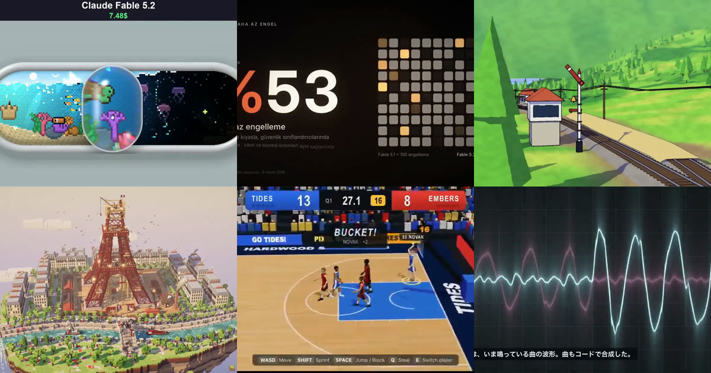

<div align="center">

<a href="https://apiko.app/zh/claude-fable-5-2-video-prompts?utm_source=github&utm_medium=banner&utm_campaign=awesome-claude-fable-5.2-video-prompts"></a>

[](LICENSE)
[](README_zh-CN.md#menu)
[](https://apiko.app/zh/models/claude-fable-5-2?utm_source=github&utm_medium=badge&utm_campaign=awesome-claude-fable-5.2-video-prompts&utm_content=model_try)
[](https://apiko.app/zh/docs/api-manual/text-series/claude?utm_source=github&utm_medium=badge&utm_campaign=awesome-claude-fable-5.2-video-prompts&utm_content=docs)

[](README.md)
[](README_zh-CN.md)
[](README_zh-TW.md)
[](README_ko.md)

</div>

# Awesome Claude Fable 5.2 视频提示词

<a id="introduction"></a>
## 🌟 简介

**Claude Fable 5.2 视频提示词：22 条真实提示词和它们做出的视频，从 WebGL 滑块、Three.js 场景到 Blender 动画和 LilyPond 音乐。**

Claude Fable 5.2 视频提示词，收集自发布后头几天创作者公开的作品。每张卡片都有作者原文提示词和它做出的视频，可以直接复制对照。

在线搜索和筛选： [apiko.app/claude-fable-5-2-video-prompts](https://apiko.app/zh/claude-fable-5-2-video-prompts?utm_source=github&utm_medium=readme&utm_campaign=awesome-claude-fable-5.2-video-prompts&utm_content=intro).

> [!NOTE]
> 提示词保持作者发布时的原文，所以大多是英文；标题和简介是我们写的。每条都署名作者并链接原帖。

<a id="quick-start"></a>
## 🚀 快速开始

**网页上用：** 每条都有「在 APIKO 运行」链接，会在 [apiko.app](https://apiko.app/zh/claude-fable-5-2-video-prompts?utm_source=github&utm_medium=quickstart&utm_campaign=awesome-claude-fable-5.2-video-prompts&utm_content=browser) 打开这条示例；点「使用」，提示词就会填进 Claude Fable 5.2 试用台。

**用 API：** 先创建 [APIKO API Key](https://apiko.app/zh/dashboard/apikeys?utm_source=github&utm_medium=quickstart&utm_campaign=awesome-claude-fable-5.2-video-prompts&utm_content=api_key)，把提示词发到 Messages API。Claude 返回代码，在你的电脑上运行它来渲染视频。

```bash
export APIKO_API_KEY="your_key_here"

curl -s https://api.apiko.app/v1/messages \
  -H "Authorization: Bearer $APIKO_API_KEY" \
  -H "anthropic-version: 2023-06-01" \
  -H "Content-Type: application/json" \
  -d '{
  "model": "claude-fable-5-2",
  "max_tokens": 16000,
  "messages": [{
    "role": "user",
    "content": "Write one self-contained index.html that animates a paper boat crossing a lake at sunrise for 10 seconds at 1920x1080, plus the Playwright and FFmpeg commands that render it to boat.mp4."
  }]
}' | python3 -c 'import json,sys; print("".join(b.get("text","") for b in json.load(sys.stdin)["content"]))'
```

接口: `POST https://api.apiko.app/v1/messages` (发送提示词)

<a id="how-to-write"></a>
## ✍️ 怎么写 Claude Fable 5.2 视频提示词

Claude Fable 5.2 输出的是代码，不是视频文件。代码在你的电脑上渲染并逐帧录下来。先定好路线，并在提示词里写明。

- **单个自包含页面** · `单个 HTML + WebGL 或 Canvas + Web Audio +「不用任何库」` — 两张音量滑块卡片要求一个页面里只用原生 WebGL2、Web Audio 和像素缓冲。这种页面在浏览器里打开就能录屏。
- **Three.js 加帧时钟** · `场景 + 时长 + 尺寸 + 帧率 + window.renderAt(t)` — 体素巴黎那张卡要求暴露 renderAt(t)，可以按固定帧率逐帧截取。视频要求精确、不能靠实时录屏时就这样写。
- **Remotion 或 HyperFrames** · `框架 + 时长 + 要卖什么 + 项目目录` — 预告片类卡片点名 HyperFrames 或 Remotion，并在项目里运行，让模型先读真实的产品再写片子。
- **Blender 和 LilyPond** · `工具 + 主题 + 渲染设置，或「只要代码块」` — 动画短片在 Blender 里用 Python 搭每个镜头；音乐卡片只要 LilyPond 代码。两者都要在本机装好对应工具，才能把代码变成视频。
- **每次都要写清楚的** · `时长 + 分辨率 + 帧率 + effort + 你提供的素材` — 写了时长的卡片都拿到了对应时长。要说明你会提供哪些素材（歌曲、歌词、项目目录），这里有四张卡片依赖它们。

**这些 Claude Fable 5.2 案例说明了什么**

- **一句话可能就够** UFO、Logo 揭幕和「只用代码」的发布片都只有一句话。长规格是为了精确的效果，比如 6,000 字的滑块研究。
- **创作者报了成本** 两个滑块分别花了 $7.48 和 $8.43；自制发布片跑了 57 分钟，按 API 价约 $21。长任务要留预算。
- **大活要用 Agent 跑** 60 秒发布片调用了 Opus 5.5 子代理，犯罪题材游戏跑了两个多小时。这类要在 Claude Code 等 Agent 里跑，不是一次 API 调用。
- **effort 有影响** 音乐卡片用 Extra High，巫师短片用 high，预告片用 medium。Fable 5.2 每次请求都会思考，默认是 high。
- **Opus 5.5 依然接近** 有两位作者在两个模型上跑了同一条提示词，其中一位更喜欢 Opus 5.5 的结果。换模型前先用自己的点子比一比。

<a id="menu"></a>
## 📑 目录

- [✨ 动效](#motion-graphics) (6)
  - [两句话做一支告别 Opus 5.5 的作品集短片](#motion-graphics-01)
  - [粒子文字变成星系、双螺旋，最后拼出你的名字](#motion-graphics-02)
  - [一根潜入海底世界的音量滑块](#motion-graphics-03)
  - [从黑夜滑到清晨的温馨小屋开关](#motion-graphics-04)
  - [铬金属质感的 3D Logo 揭幕](#motion-graphics-05)
  - [一句话 15 秒动效设计师作品集](#motion-graphics-06)
- [🚀 发布与宣传](#product-launch) (4)
  - [调用 Opus 5.5 子代理做的 60 秒发布片](#product-launch-01)
  - [「做你自己的发布视频，只用代码」](#product-launch-02)
  - [用 HyperFrames 做的课程社媒预告片](#product-launch-03)
  - [一条提示词做出发布会质感的知识站宣传片](#product-launch-04)
- [🎞️ 短片](#short-film) (4)
  - [蒸汽火车变形成机器人的 2D 动画短片](#short-film-01)
  - [UFO 降落 51 区并和人类打招呼](#short-film-02)
  - [小巫师亲手造出并发布 Fable 5.2](#short-film-03)
  - [剑齿虎捕猎，纯代码动画](#short-film-04)
- [• 3D 场景](#3d-scenes) (2)
  - [用 Blender 搭的古耶路撒冷沉浸式 3D 模型](#3d-scenes-01)
  - [1888 年的悬浮体素巴黎，逐帧渲染](#3d-scenes-02)
- [• 游戏](#games) (2)
  - [一次生成的 Three.js 3D 篮球游戏](#games-01)
  - [80 年代迈阿密风格城市里的开放世界游戏](#games-02)
- [• 音乐](#music) (4)
  - [用 LilyPond 写的 G 小调巴赫风格众赞歌](#music-01)
  - [给歌和歌词做的日语歌词动态视频](#music-02)
  - [从一个点长成整个世界：着色器影片配代码合成音乐](#music-03)
  - [用 LilyPond 写的完整巴赫风格管风琴赋格](#music-04)
- [❓ 常见问题](#faq)
- [🔗 相关链接](#related)

<a id="motion-graphics"></a>
## ✨ 动效

> 作品集短片、Logo 揭幕和界面开关，用 HTML、WebGL 和着色器画出来。 · 6 条

<a id="motion-graphics-01"></a>
### 1. 两句话做一支告别 Opus 5.5 的作品集短片

作者 [@kaif9998](https://x.com/kaif9998) · 15 秒 · 16:9 · **[▶ 在 APIKO 运行](https://apiko.app/zh/claude-fable-5-2-video-prompts?utm_source=github&utm_medium=case&utm_campaign=awesome-claude-fable-5.2-video-prompts&utm_content=motion-graphics-01#motion-graphics-01)** · [原帖](https://x.com/kaif9998/status/2119903824848761287)

在 Claude Code 里先要一段 15 秒告别视频，再补一句「做成作品集」。

<a href="https://apiko.app/zh/claude-fable-5-2-video-prompts?utm_source=github&utm_medium=case&utm_campaign=awesome-claude-fable-5.2-video-prompts&utm_content=motion-graphics-01#motion-graphics-01"></a>

**提示词:**

```text
Claude Code , two prompts:

1. "make a 15 second animated video that says final goodbye to Opus 5.5 as Fable 5.2 is here and I switched to it"
2. "make the video like it's your showreel"
```

<a id="motion-graphics-02"></a>
### 2. 粒子文字变成星系、双螺旋，最后拼出你的名字

作者 [@ici_dab](https://x.com/ici_dab) · 68 秒 · 1:1 · **[▶ 在 APIKO 运行](https://apiko.app/zh/claude-fable-5-2-video-prompts?utm_source=github&utm_medium=case&utm_campaign=awesome-claude-fable-5.2-video-prompts&utm_content=motion-graphics-02#motion-graphics-02)** · [原帖](https://x.com/ici_dab/status/2119901910237098351)

一段开放需求：做一个最能震撼人、能直接分享的作品。结果是带配乐的交互式粒子动画。

<a href="https://apiko.app/zh/claude-fable-5-2-video-prompts?utm_source=github&utm_medium=case&utm_campaign=awesome-claude-fable-5.2-video-prompts&utm_content=motion-graphics-02#motion-graphics-02"></a>

**提示词:**

```text
the prompt: "I need you to create the most impressive thing I can share with people when you launch. It needs to be embeddable in a post and i can preface it however you like. it needs to have a visceral impact on people to show what you can do and the range of capabilities. It should grab them quickly. Be amazingly clever about this."
```

<a id="motion-graphics-03"></a>
### 3. 一根潜入海底世界的音量滑块

作者 [@N1njaCodex](https://x.com/N1njaCodex) · 11 秒 · 16:9 · **[▶ 在 APIKO 运行](https://apiko.app/zh/claude-fable-5-2-video-prompts?utm_source=github&utm_medium=case&utm_campaign=awesome-claude-fable-5.2-video-prompts&utm_content=motion-graphics-03#motion-graphics-03)** · [原帖](https://x.com/N1njaCodex/status/2119883560937001387)

长规格说明：纯 WebGL2 + Web Audio、不用任何库的开关组件。作者称这次花了 $7.48。

<a href="https://apiko.app/zh/claude-fable-5-2-video-prompts?utm_source=github&utm_medium=case&utm_campaign=awesome-claude-fable-5.2-video-prompts&utm_content=motion-graphics-03#motion-graphics-03"></a>

**提示词:**

```text
Make "Deep Dive Switch", No. 063 in a series of web material studies: a depth switch that goes from light to dark, from the sea's surface to the floor of the abyss. Build it as one self-contained page with no libraries: raw WebGL2, Web Audio and a 2D pixel buffer.

PAGE
- Editorial layout: a small kicker "Material Studies / No. 063 · WebGL + Web Audio", an italic serif title "Deep Dive Switch.", and a one-line caption.
- The switch sits centred and large. Below it go three readouts (Depth, Zone, Music), a hint line and a "Sound on/off" button.
- The whole page's colours (background, text, lines) follow the depth: pale aqua at the surface, near-black blue in the abyss.
- It must work at phone width.

THE SWITCH
- A pill-shaped switch in a moulded bezel: white glossy plastic at the surface, deep navy in the abyss.
  - A soft drop shadow falls on the page and fades to nothing before the canvas edge.
  - A slight inner shadow runs along the top of the track.
- Inside it is a 176×50 pixel-art cross-section of the sea.
  - Redraw it every frame on the CPU and show it with nearest sampling, never smoothed.
  - Use whole device pixels per scene pixel where there is room.
- The knob is a glass bathysphere: a vertical capsule of clear glass, a little taller than the track, drawn in a single full-canvas WebGL2 fragment shader.
  - It magnifies what is under it (about 1.28×) and bends it.
  - At its rim it splits R, G and B. A darker refraction band sits inside a bright edge, with a Fresnel tint and a faint aqua cast.
  - Two highlights: a long soft streak at the upper left and a small dot at the lower right.
  - Light gathers toward its foot, and it casts a soft shadow on the scene.
- Motion:
  - It follows the finger on a spring, lagging a little.
  - It stretches sideways with speed and squashes vertically to keep its volume.
  - It wobbles on a damped spring driven by its acceleration.
- Controls:
  - Drag the knob, or drag anywhere on the track.
  - Tap to send it to the other end; it travels there on its spring.
  - Arrow keys, Home/End and Space/Enter also work.
  - The switch has role="slider" with ARIA values.

THE SEA (left = shallow, right = deep; an original palette)
- Sprites are filled shapes stamped with an automatic 1-px outline and a light top / dark bottom.
- The sea floor, left to right:
  - a sandy beach with a sandcastle;
  - a reef plateau with rocks;
  - a drop-off into rocky deep water;
  - the abyssal floor rising again at the far right.
- Up top on the left is sky with a sun, two flapping gulls and a little red sailboat bobbing on animated waves with a foam line.
  - The surface is level over the shallows, then rises out of the picture toward the deep, so the view seems to sink.
- The shallows:
  - turquoise water with swaying slanted god rays and moving caustics on the sand;
  - branching corals in pink, orange and violet, brain corals, swaying sea grass;
  - an anemone with a little orange-and-white fish darting about it;
  - a sea turtle gliding back and forth, paddling;
  - a school of yellow fish circling over the reef that scatters away from the knob.
- The twilight zone:
  - the water darkens to deep blue;
  - three translucent jellyfish, pink and violet, pulse and trail wavy tentacles; they glow softly and pulse faster when the knob comes near;
  - every half minute a faint whale silhouette swims past in the background.
- The midnight zone:
  - a long swaying chain of glowing cyan-and-green beads (a siphonophore);
  - small dark lanternfish with blinking light spots;
  - marine snow drifting down.
- The abyssal floor:
  - a hydrothermal vent breathing bubbles;
  - an anglerfish with a rod and a glowing lure;
  - a treasure chest.

LIGHT AND THE DIVE
- Daylight falls off with depth and dims a little toward the floor. It is quantised and Bayer-dithered so the gradient steps like pixel art.
- Below the shallows the bathysphere's searchlight comes on: a stepped, dithered pool of light around the knob, with a blue haze scattered in the water.
- Inside the lens everything is shown lit.
- Behind the knob trail rising bubbles and, in the dark, sparks of blue bioluminescence.
- Glowing crescent echoes trail behind it: pale aqua in the shallows, cyan in the deep.
- The lure lights its own little pool.
- As the knob nears, the anglerfish turns and opens its toothy mouth wide, and its lure blazes.
- At the very bottom the chest lid swings open on glowing gold, and gold glints fly up from it.

SOUND — all synthesised live with Web Audio, original music
- 84 BPM, a four-bar loop in D minor (Dm7 · B♭maj7 · Gm7 · A7sus4), on one lookahead-scheduled clock with a little swing.
- Layers fade in and out with depth:
  0. The surface: waves (filtered noise swelling slowly) and gull cries. The moment you go under, a splash, and the waves drop to a dull underwater roar.
  1. The reef: a kalimba ostinato (sine with bright, quickly fading overtones, in a long reverb), with bubbles popping on the off-beats.
  2. A soft dub beat: a round kick, rim clicks into a dotted echo, a swung shaker, a deep bass.
  3. The twilight: slow detuned pads, a whale singing now and then (a gliding, vibrato tone through a formant filter), then sonar pings ringing in the echo.
  4. The abyss: a breathing sub drone, a slow lub-dub heartbeat, and glassy arpeggios of high pentatonic notes ringing in the echo.
- The music sits behind a gentle low-pass that closes a little with depth, about 5 dB under the switch's own sounds.
- Switch sounds:
  - a bubble bloop when grabbed, a plop when released;
  - a water swish and bubble pops that grow with drag speed;
  - a splash crossing the surface either way;
  - a glass chime past each jellyfish;
  - the angler's deep gulp;
  - a fanfare when the chest opens: a rising kalimba arpeggio, a low boom and a shimmer.
- Audio starts on the first touch; a Sound on/off button.

READOUTS
- Depth, 0 → 6,000 m, mapped to the zones.
- Zone: Surface / Sunlit / Twilight / Midnight / Abyss.
- Music: Waves / Kalimba / Reef dub / Whale song / Sonar / Abyss.
```

<a id="motion-graphics-04"></a>
### 4. 从黑夜滑到清晨的温馨小屋开关

作者 [@vib3coded](https://x.com/vib3coded) · 13 秒 · 16:9 · **[▶ 在 APIKO 运行](https://apiko.app/zh/claude-fable-5-2-video-prompts?utm_source=github&utm_medium=case&utm_campaign=awesome-claude-fable-5.2-video-prompts&utm_content=motion-graphics-04#motion-graphics-04)** · [原帖](https://x.com/vib3coded/status/2119876781700505627)

同一套「材质研究」格式，单页 WebGL2 + Web Audio。作者称用了 10 分钟、$8.43。

<a href="https://apiko.app/zh/claude-fable-5-2-video-prompts?utm_source=github&utm_medium=case&utm_campaign=awesome-claude-fable-5.2-video-prompts&utm_content=motion-graphics-04#motion-graphics-04"></a>

**提示词:**

```text
Make "Daybreak Switch", No. 062 in a series of web material studies: a night-to-morning toggle in its own original style, as a single self-contained page (no libraries; raw WebGL2 + Web Audio + a 2D pixel buffer). Editorial layout: a small "Material Studies / No. 062 · WebGL + Web Audio" kicker, an italic serif title "Daybreak Switch.", a one-line caption; the switch centred and large; below it readouts (Clock, Light, Music), a hint line and a "Sound on/off" button. The whole page's colours (background, text, lines) follow the switch from a dark dusk-indigo at night to a pale lavender-grey by day. Works at phone width.

THE SWITCH
- A pill-shaped switch in a moulded bezel: white glossy plastic by day, graphite by night. A soft drop shadow falls on the page and fades to nothing before the canvas edge, with a slight inner shadow along the top of the track.
- Inside, a 176×50 pixel-art room, redrawn every frame on the CPU and shown with nearest sampling, never smoothed. Whole device pixels per scene pixel where there is room.
- The knob is a vertical capsule of clear jelly glass, a little taller than the track, drawn in one full-canvas WebGL2 fragment shader:
  - it magnifies (~1.28×) and bends the pixels under it;
  - it splits R/G/B at its rim, with a darker refraction band, a bright edge and a Fresnel tint;
  - two highlights: a long soft streak at the upper left and a small dot at the lower right;
  - light focused toward its foot, and a soft shadow on the room.
- The knob lags the finger on a spring, stretches horizontally with speed (squashing vertically to keep its volume), and wobbles on a damped spring fed by its acceleration.
- Inside the knob the room is always shown fully lit: the glass carries the morning.
- Controls: drag the knob or drag anywhere on the track; tap to toggle to the other end (it travels there on its spring); arrow keys, Home/End, Space/Enter; role="slider" with aria values.

THE ROOM (original, cosy palette)
Built from filled shapes stamped with an automatic 1-px outline and a light top / dark bottom, so every object reads as a pixel sprite:
- butter-yellow diamond wallpaper, teal wainscot, plank floor, a coral/cream/teal striped rug;
- a big window with curtains over a town of roofs;
- a shelf of coloured jelly jars and books, a potted plant;
- a brass floor lamp with a mint shade;
- a red boombox on a wooden cabinet, a framed picture of a little jelly shark, a round wall clock, a blue panelled door;
- a string of coloured bulbs sagging across the ceiling;
- a purple pet bed under the window.

LIGHT AND THE MORNING
- The knob drags the dawn across the room: left of it is day, right of it still night (indigo ambient). The edge dissolves in a 4×4 Bayer dither, with a warm dawn band just behind the knob.
- The window sky runs from night (navy, twinkling stars, a crescent moon, lit town windows) through dawn (violet to peach, the sun coming up) to day (blue, sun high, clouds drifting).
- Moonlight shafts through the window at night, warm sun shafts by day.
- The lamp clicks on early and casts a banded warm pool.
- Each ceiling bulb lights as the knob passes it, with a coloured dithered glow.
- Disco spots sweep the room at the party.
- The wall clock runs from 02:00 to 10:00.

THE STORY, BY POSITION
- An orange tabby cat:
  - asleep, curled in its bed, breathing, with z's rising;
  - awake, lying with its head up and blinking;
  - sitting up;
  - standing and walking out onto the rug;
  - at the end dancing on its hind legs to the beat, in sunglasses, with pink ghost trails.
- The plant sways and the boombox speakers thump with the beat; music notes float up from the boombox.
- A disco ball comes down from the ceiling; confetti sparkles fall.
- Glowing crescent echoes (coral to pink) trail behind the moving knob.
- Near the end (from about 08:24 on the clock) a puppy waits outside: warm light shows under the door with the shadows of its shifting paws, and it knocks. On each knock the door jolts 2 px, arcs of sound spring off it, and a "!" pops up over the cat; the knocking repeats every ~2.8 s until it's let in. At the very end the door swings open on a warm orange hallway and a white puppy with brown ears comes in, bobbing to the beat.

SOUND — all synthesised live with Web Audio, original music
- 100 BPM, a four-bar loop in F (Fmaj7 · Am7 · Dm7 · B♭maj7), on one lookahead-scheduled clock with a little swing.
- Layers fade in by the knob's position:
  0. Night: crickets (AM-chirped sine trains) and soft wind.
  1. A music box arpeggiating the chords (bell partials, short room reverb).
  2. A lo-fi beat (kick, noise-and-tone snare, hats) and a round bass.
  3. Warm detuned pads and a square-wave tune with vibrato.
  4. The party: four on the floor, claps, open hats, sub bass, the rest of the mix pumping under the kick.
- The music sits behind a low-pass that opens with the dawn, and ~5 dB under the switch's own sounds.
- Switch sounds:
  - a glass tink plus a jelly blop when grabbed, a plop when released;
  - a band-passed noise rub following the drag speed;
  - a pentatonic pluck for every bulb lit (a glissando when you sweep across), softer and lower when one goes out;
  - the lamp's double click and a cat's "mrrp" (formant-filtered saw) when it wakes;
  - a riser and crash into the party, and a record-brake when you drag back out of the beat;
  - the puppy's yip when it comes in.
- The knock, like a real heavy door knock: three hits 0.25 s apart, panned toward the door. Each hit is a knuckle click (band-passed noise) over a deep thump that sags from ~98 to ~60 Hz over a quarter second, with quicker overtones (190→128 Hz, 410 Hz) and soft saturation so small speakers hear it. The music ducks to ~45% under each hit, and the knocks peak at 3–4× the music's level.
- Audio starts on the first touch; a Sound on/off button.
- Readouts: Clock (02:00–10:00), Light (Night / First light / Sunrise / Morning / Party), Music (Crickets / Music box / Beat / Band / Party).
```

<a id="motion-graphics-05"></a>
### 5. 铬金属质感的 3D Logo 揭幕

作者 [@hello_amani](https://x.com/hello_amani) · 36 秒 · 1:1 · **[▶ 在 APIKO 运行](https://apiko.app/zh/claude-fable-5-2-video-prompts?utm_source=github&utm_medium=case&utm_campaign=awesome-claude-fable-5.2-video-prompts&utm_content=motion-graphics-05#motion-graphics-05)** · [原帖](https://x.com/hello_amani/status/2119873980786237842)

一句话：用铬金属和网格做我的 Logo 3D 揭幕，多迭代几轮。

<a href="https://apiko.app/zh/claude-fable-5-2-video-prompts?utm_source=github&utm_medium=case&utm_campaign=awesome-claude-fable-5.2-video-prompts&utm_content=motion-graphics-05#motion-graphics-05"></a>

**提示词:**

```text
the prompt was: make my logo reveal in 3D with chromatic metal and grids
and bunch of iteration
```

<a id="motion-graphics-06"></a>
### 6. 一句话 15 秒动效设计师作品集

作者 [@himanshutwtxs](https://x.com/himanshutwtxs) · 15 秒 · 16:9 · **[▶ 在 APIKO 运行](https://apiko.app/zh/claude-fable-5-2-video-prompts?utm_source=github&utm_medium=case&utm_campaign=awesome-claude-fable-5.2-video-prompts&utm_content=motion-graphics-06#motion-graphics-06)** · [原帖](https://x.com/himanshutwtxs/status/2120017106804900304)

很多人在 Opus 5.5 上跑过的同一句话，换成 Fable 5.2：缓动、字体、景深、节奏都在一支片里。

<a href="https://apiko.app/zh/claude-fable-5-2-video-prompts?utm_source=github&utm_medium=case&utm_campaign=awesome-claude-fable-5.2-video-prompts&utm_content=motion-graphics-06#motion-graphics-06"></a>

**提示词:**

```text
make a dynamic 15-second motion graphics video that shows what an incredible motion designer you are, like it's your showreel for a résumé. go all out
```

<a id="product-launch"></a>
## 🚀 发布与宣传

> 发布片和预告片，从一句「只用代码」到让模型先调研整个项目目录。 · 4 条

<a id="product-launch-01"></a>
### 7. 调用 Opus 5.5 子代理做的 60 秒发布片

作者 [@grafikcem](https://x.com/grafikcem) · 60 秒 · 16:9 · **[▶ 在 APIKO 运行](https://apiko.app/zh/claude-fable-5-2-video-prompts?utm_source=github&utm_medium=case&utm_campaign=awesome-claude-fable-5.2-video-prompts&utm_content=product-launch-01#product-launch-01)** · [原帖](https://x.com/grafikcem/status/2119910525064937806)

土耳其语提示词：在发布当天，用 Opus 5.5 子代理给 Fable 5.2 做一支 60 秒动画宣传片。

<a href="https://apiko.app/zh/claude-fable-5-2-video-prompts?utm_source=github&utm_medium=case&utm_campaign=awesome-claude-fable-5.2-video-prompts&utm_content=product-launch-01#product-launch-01"></a>

**提示词:**

```text
Bugün duyurulmana özel Fable 5.2 modeli için opus 5.5 subagentları kullanarak kendine 60 saniyelik bir tanıtım animasyon filmi hazırla.
```

<a id="product-launch-02"></a>
### 8. 「做你自己的发布视频，只用代码」

作者 [@furkancavlakcom](https://x.com/furkancavlakcom) · 74 秒 · 16:9 · **[▶ 在 APIKO 运行](https://apiko.app/zh/claude-fable-5-2-video-prompts?utm_source=github&utm_medium=case&utm_campaign=awesome-claude-fable-5.2-video-prompts&utm_content=product-launch-02#product-launch-02)** · [原帖](https://x.com/furkancavlakcom/status/2119896886345695521)

一句土耳其语。作者称用了 57 分钟、按 API 价约 $21、1,702 行 Python、2,220 帧，音乐也是合成的。

<a href="https://apiko.app/zh/claude-fable-5-2-video-prompts?utm_source=github&utm_medium=case&utm_campaign=awesome-claude-fable-5.2-video-prompts&utm_content=product-launch-02#product-launch-02"></a>

**提示词:**

```text
Kendi lansman videonu yap. Sadece kodla.
```

<a id="product-launch-03"></a>
### 9. 用 HyperFrames 做的课程社媒预告片

作者 [@midudev](https://x.com/midudev) · 32 秒 · 9:16 · **[▶ 在 APIKO 运行](https://apiko.app/zh/claude-fable-5-2-video-prompts?utm_source=github&utm_medium=case&utm_campaign=awesome-claude-fable-5.2-video-prompts&utm_content=product-launch-03#product-launch-03)** · [原帖](https://x.com/midudev/status/2119876297304203273)

西班牙语提示词，在作者自己的项目里运行：要有声音、动画要炸，medium 档位，约 10 分钟。

<a href="https://apiko.app/zh/claude-fable-5-2-video-prompts?utm_source=github&utm_medium=case&utm_campaign=awesome-claude-fable-5.2-video-prompts&utm_content=product-launch-03#product-launch-03"></a>

**提示词:**

```text
El prompt:  Crea un trailer en video animado para compartir en redes sociales de este proyecto. Quiero que lo vendas de forma espectacular, que tenga sonido y animaciones brutales. Usa hyperframes.

Esfuerzo medio.
```

<a id="product-launch-04"></a>
### 10. 一条提示词做出发布会质感的知识站宣传片

作者 [@czzzzzzJ_](https://x.com/czzzzzzJ_) · 298 秒 · 16:9 · **[▶ 在 APIKO 运行](https://apiko.app/zh/claude-fable-5-2-video-prompts?utm_source=github&utm_medium=case&utm_campaign=awesome-claude-fable-5.2-video-prompts&utm_content=product-launch-04#product-launch-04)** · [原帖](https://x.com/czzzzzzJ_/status/2120023093464682817)

在知识站项目目录里运行：先调研业务，只问一轮问题，然后直接成片，风格像苹果发布会。

<a href="https://apiko.app/zh/claude-fable-5-2-video-prompts?utm_source=github&utm_medium=case&utm_campaign=awesome-claude-fable-5.2-video-prompts&utm_content=product-launch-04#product-launch-04"></a>

**提示词:**

```text
你现在在我的知识站项目目录下，完整地调研我知识站上所有的业务、提供的内容，以及我的商业模式。使用 opuscar这个库帮我生成我的知识站宣传视频，整体风格我希望是像苹果的发布会那种风格质感。素材可以自行搜索和获取截屏。关于我不了解的内容，DOC 文件夹下有我的个人介绍。在整个宣传片制作前，你有一次向我提问的机会，收集我的想法，然后我要求你直接成片。
```

<a id="short-film"></a>
## 🎞️ 短片

> 用代码讲故事：Blender 日式动画、Three.js 的 UFO、角色动画和动物捕猎。 · 4 条

<a id="short-film-01"></a>
### 11. 蒸汽火车变形成机器人的 2D 动画短片

作者 [@0kncn](https://x.com/0kncn) · 90 秒 · 16:9 · **[▶ 在 APIKO 运行](https://apiko.app/zh/claude-fable-5-2-video-prompts?utm_source=github&utm_medium=case&utm_campaign=awesome-claude-fable-5.2-video-prompts&utm_content=short-film-01#short-film-01)** · [原帖](https://x.com/0kncn/status/2119901782482543073)

长规格说明：全部在 Blender 里用 Python 搭建，Eevee 渲染，再逐帧描线上色，音乐自己合成。90 秒。

<a href="https://apiko.app/zh/claude-fable-5-2-video-prompts?utm_source=github&utm_medium=case&utm_campaign=awesome-claude-fable-5.2-video-prompts&utm_content=short-film-01#short-film-01"></a>

**提示词:**

```text
Create a 2D anime short. It must look completely like real Japanese anime, as if it were taken directly from a finished theatrical anime film. This is traditional-looking, hand-drawn 2D anime, not a 3D animation, a moving illustration, or a stylized web graphic.

Build everything in Blender from Python, render it in Eevee, then ink and paint every frame in a second pass. Deliver one 1920x1080, 24 fps MP4 with a synthesized soundtrack. Use any tools, libraries, references, guides, literally anything, as long as the final result looks 100% like hand-drawn 2D anime.

Use theatrical anime as the art style reference for the design, line work, painted backgrounds, color and atmosphere. The film is 90 seconds long (2160 frames), in 42 shots. Its hero is a steam locomotive that transforms into a robot. No people appear in the film.

HERO
No. 9, a 1940s 2-8-2 freight locomotive with a four-axle tender, 23 m long, asleep for decades in a mountain engine shed: matte black boiler with rust runs, faded red wheel centres and buffer beam, brass number plate "9", one large headlamp, two amber marker lamps, moss on the running boards, ivy through the cab windows, and a stork's nest on the cab roof. As a robot it stands 21 m tall with its shoulders at 17 m. It is an original design, not a character from any existing series. It moves on twos, slow and heavy. Its wheels never slip and its feet never slide.

TRANSFORM
One transformation, at full speed, 120 frames, in five stages of 24 frames. Every part is rigid: nothing stretches, nothing vanishes, nothing appears. Each part travels on a hinge or a slide you can see.
1. Legs: the tender uncouples, splits lengthwise and swings down; its two bogies lock as feet, the coal stays in bunkers on the calves.
2. Hips: the cab drops and widens into the pelvis; the trailing truck folds onto the lower back.
3. Torso: the boiler tilts upright, firebox at the waist, smokebox at the top; the chimney and steam dome end on the upper back and keep venting.
4. Arms: the running boards swing out with the cylinders as shoulders, the piston and connecting rods as forearms, and hands with three fingers and a thumb unfolding from the valve gear; the front driving wheels ride up as shoulder discs, the rear ones fold to hips and knees.
5. Head: the smokebox door hinges forward as the chest plate with the headlamp at its centre; a riveted helmet rises from the smokebox with one dark visor slit and the two marker lamps as amber eyes; the cowcatcher folds up as a collar.
The cab roof panel rides up to the right shoulder and carries the stork's nest, never tilted more than 10 degrees.
Stages 1-3 happen on the rails, with the first strides landing on the ballast either side of the track. Stages 4-5 happen in the air.

WORLD
A single-track mountain railway at real scale. At the top, an ore mine with a loading bunker and a rake of twelve four-wheel hopper wagons. The line descends through larch forest and a short rock tunnel to a viaduct: seven 18 m steel girder spans on stone piers, 126 m long, the deck 17 m above a turquoise meltwater river 3 m deep. Beyond it, a small station: a stone engine shed, a water tower, a semaphore signal with an alarm bell, a signal box, a siding ending in a sand drag. Snow peaks behind, a cliff face above the viaduct, telegraph poles along the whole line.

STORY
A clear spring morning in the valley. Meltwater loosens the cliff: a rockfall hits the middle pier of the viaduct, the pier collapses into the river and the two girders it carried sag into a V, held only by the rails. Up at the mine the shock snaps a coupling and the twelve loaded wagons start to roll downhill, unmanned. At the station the semaphore drops to danger and the bell rings. In the dark shed the firebox glows, the pressure needle climbs, the headlamp lights; the stork flies up. No. 9 bursts through the shed doors tearing ivy and rust, and charges up the grade with the wagons coming down the other side. On the approach it transforms at full speed, leaps from the abutment, lands crouched in the river, wades to the fallen pier, and lifts the sagging joint onto its shoulders and raised hands. The wagons hit the viaduct: it sinks 0.3 m as each one passes over and holds. The rake runs through the station into the sand drag and stops. No. 9 does not come back out. It locks its knees and stays as the new pier. The steam thins, the stork returns to its nest, the visor dims.

LIGHT
High-key anime light, never murky: a morning sun from the south-east, a saturated cobalt sky, white cumulus with lavender shadows, snow peaks with blue shadows, fresh green larch, a turquoise river with drawn white water. Light only changes with a cause you can see: rock dust dims the gorge for 3 seconds, steam whites out a frame, the firebox throws orange onto the shed walls. Cel light with hard shadows, gouache backgrounds, ink lines on every machine, rail and building, effects drawn on twos: steam as inked rolling shapes with a flat shadow tone, water as inked sheets with foam crowns, dust as drawn clouds, never particle mush.

SOUND
A synthesized orchestra on a 144 bpm grid: one beat is 10 frames, and every cut lands on a multiple of 5 frames. A hopeful theme on clarinet and horn, the collapse in E minor, a 12/8 chase with the exhaust chuff as percussion at four beats per wheel revolution, a heavy 3/4 for the hold with one low drum per wagon. 16 hits land exactly on the picture: the rockfall, the pier, the coupling, the signal arm, the shed doors, each transformation lock, the landing, the lift, the first and last wagon. The steam whistle is heard twice: once on waking, once on the hold.

FORMAT
Write the film as a Python story clock: one state per frame for every pose, camera, wheel angle, rod position, transformation part, wagon, effect and sound cue.

CHECKS
Before the final render a script tests every frame on the real meshes: no part of No. 9 goes through another part, in either form or at any frame of the transformation; the total volume of its parts is the same in both forms; every wheel on a rail turns exactly as far as it travels; planted feet do not move; No. 9 never goes through the track, the shed, the viaduct or the riverbed; the wagons stay on the rails and never touch each other except at the couplings; the camera never enters a mesh, the cliff or the water; nothing jumps between frames.
```

<a id="short-film-02"></a>
### 12. UFO 降落 51 区并和人类打招呼

作者 [@danteeonsol](https://x.com/danteeonsol) · 30 秒 · 16:9 · **[▶ 在 APIKO 运行](https://apiko.app/zh/claude-fable-5-2-video-prompts?utm_source=github&utm_medium=case&utm_campaign=awesome-claude-fable-5.2-video-prompts&utm_content=short-film-02#short-film-02)** · [原帖](https://x.com/danteeonsol/status/2119887623070077213)

一句话。作者说全部用 three.js + Remotion 写成，没有外部模型、贴图和素材音效。

<a href="https://apiko.app/zh/claude-fable-5-2-video-prompts?utm_source=github&utm_medium=case&utm_campaign=awesome-claude-fable-5.2-video-prompts&utm_content=short-film-02#short-film-02"></a>

**提示词:**

```text
make me a 30 second video of a UFO visiting Area 51 and greeting humans, ultra detailed, cinematic lighting
```

<a id="short-film-03"></a>
### 13. 小巫师亲手造出并发布 Fable 5.2

作者 [@other__reality](https://x.com/other__reality) · 26 秒 · 16:9 · **[▶ 在 APIKO 运行](https://apiko.app/zh/claude-fable-5-2-video-prompts?utm_source=github&utm_medium=case&utm_campaign=awesome-claude-fable-5.2-video-prompts&utm_content=short-film-03#short-film-03)** · [原帖](https://x.com/other__reality/status/2119885430627913784)

high 档位，在作者已有的动画底稿上运行，复现时需要一个类似的起始项目。

<a href="https://apiko.app/zh/claude-fable-5-2-video-prompts?utm_source=github&utm_medium=case&utm_campaign=awesome-claude-fable-5.2-video-prompts&utm_content=short-film-03#short-film-03"></a>

**提示词:**

```text
Create an animated video of clawd creating and releasing Claude Fable 5.2
```

<a id="short-film-04"></a>
### 14. 剑齿虎捕猎，纯代码动画

作者 [@wshuyi](https://x.com/wshuyi) · 28 秒 · 16:9 · **[▶ 在 APIKO 运行](https://apiko.app/zh/claude-fable-5-2-video-prompts?utm_source=github&utm_medium=case&utm_campaign=awesome-claude-fable-5.2-video-prompts&utm_content=short-film-04#short-film-04)** · [原帖](https://x.com/wshuyi/status/2120014892040417720)

中文提示词：不用任何技能，纯编程动画，音效自己编程生成，30 秒以内。

<a href="https://apiko.app/zh/claude-fable-5-2-video-prompts?utm_source=github&utm_medium=case&utm_campaign=awesome-claude-fable-5.2-video-prompts&utm_content=short-film-04#short-film-04"></a>

**提示词:**

```text
不使用任何技能，做一段纯编程形成的动画视频：剑齿虎的捕猎。不用配音，你自己编程生成音效，时长控制在 30 秒以内
```

<a id="3d-scenes"></a>
## • 3D 场景

> 在 Blender 或 Three.js 里搭出一整个地方，再用镜头巡游展示。 · 2 条

<a id="3d-scenes-01"></a>
### 15. 用 Blender 搭的古耶路撒冷沉浸式 3D 模型

作者 [@kplikethebird](https://x.com/kplikethebird) · 30 秒 · 16:9 · **[▶ 在 APIKO 运行](https://apiko.app/zh/claude-fable-5-2-video-prompts?utm_source=github&utm_medium=case&utm_campaign=awesome-claude-fable-5.2-video-prompts&utm_content=3d-scenes-01#3d-scenes-01)** · [原帖](https://x.com/kplikethebird/status/2119900775727902732)

一句话，要求按史实还原某一周的整座城市。成片巡游了圣殿、园林和宫殿。

<a href="https://apiko.app/zh/claude-fable-5-2-video-prompts?utm_source=github&utm_medium=case&utm_campaign=awesome-claude-fable-5.2-video-prompts&utm_content=3d-scenes-01#3d-scenes-01"></a>

**提示词:**

```text
Build an immersive, historically accurate 3D model of Jerusalem during the week of Jesus's final visit using Blender.
```

<a id="3d-scenes-02"></a>
### 16. 1888 年的悬浮体素巴黎，逐帧渲染

作者 [@RezAIT00](https://x.com/RezAIT00) · 14 秒 · 16:9 · **[▶ 在 APIKO 运行](https://apiko.app/zh/claude-fable-5-2-video-prompts?utm_source=github&utm_medium=case&utm_campaign=awesome-claude-fable-5.2-video-prompts&utm_content=3d-scenes-02#3d-scenes-02)** · [原帖](https://x.com/RezAIT00/status/2119894257519767656)

详细的 three.js 规格，暴露 renderAt(t) 方便逐帧截取：浮岛上的巴黎，埃菲尔铁塔正在建造。

<a href="https://apiko.app/zh/claude-fable-5-2-video-prompts?utm_source=github&utm_medium=case&utm_campaign=awesome-claude-fable-5.2-video-prompts&utm_content=3d-scenes-02#3d-scenes-02"></a>

**提示词:**

```text
Build a single self-contained three.js HTML page that renders a 14-second animation (1280x720, 30fps, deterministic: expose window.renderAt(t) so every frame can be captured).  Scene: a floating voxel diorama island - Paris, 1888, the Eiffel Tower under construction. Everything is already moving on frame 1.  Island: - floating chunk with layered rock underside, the Seine curving across the front with stone quays and an arched bridge - Champ de Mars: dirt work yard, stacks of iron girders, wooden sheds, a steam engine with a smoking chimney - around it: rows of Haussmann buildings with cream walls, grey zinc roofs, chimneys, tiny trees along the boulevards  The tower (the hero): - dark reddish-brown wrought iron lattice made of thin voxel beams with real X-bracing, not solid blocks - four curved legs and the first platform finished, the second level half built, the top section only a skeleton - wooden scaffolding towers under the legs, small creeper cranes on the structure lifting girders on chains - glowing orange rivet sparks where workers hammer, small puffs of steam  Life (hundreds of tiny voxel people, ~3 voxels tall): - riveting teams on every level with hammers swinging, workers walking along beams - girders hoisted by cranes swinging slowly into place - horse-drawn carts carrying iron across the yard, crowds of onlookers in 1880s clothes with top hats and parasols - a riverboat with a smoking funnel moving along the Seine, carriages crossing the bridge, pigeons circling the tower  Camera and look: - wide view of the whole island, slow orbit (~25 degrees) with a gentle push-in toward the tower - warm late-afternoon sun, soft shadows, ambient occlusion, light haze, rounded voxels, ACES tone mapping, soft bloom on sparks

Full credits go to @semichenkko for this prompt
```

<a id="games"></a>
## • 游戏

> 一条提示词做出的 Three.js 可玩游戏，视频是试玩录屏。 · 2 条

<a id="games-01"></a>
### 17. 一次生成的 Three.js 3D 篮球游戏

作者 [@joshvlc](https://x.com/joshvlc) · 19 秒 · 21:9 · **[▶ 在 APIKO 运行](https://apiko.app/zh/claude-fable-5-2-video-prompts?utm_source=github&utm_medium=case&utm_campaign=awesome-claude-fable-5.2-video-prompts&utm_content=games-01#games-01)** · [原帖](https://x.com/joshvlc/status/2119894656221958575)

直白列出规则和操作：运球、跳投、扣篮、抢断、传球、两支队。一次成型。

<a href="https://apiko.app/zh/claude-fable-5-2-video-prompts?utm_source=github&utm_medium=case&utm_campaign=awesome-claude-fable-5.2-video-prompts&utm_content=games-01#games-01"></a>

**提示词:**

```text
Can you make a 3D basketball game using THREE.js? It should have a player in two different colored uniforms for the two teams and should follow the basic rules of basketball. It should have basic funcionality:
- dribble (happens automatically when player runs)
- shoot (hold for jump shot); dunk automatically near rim; jump/block if you don't have the ball
- steal
- pass to teammate
- 1 player: the teammates should be CPU and play normally (they should get open for you) and the player always controls the person with the ball (if someone on their team has it); the other team should be CPU controlled
- fouls + penalty shots
- the game should start on a tip (hit shoot button to tip)
Note: include sound effects and crowd cheering! You can use Blender (installed on this machine) if needed for the graphics!
```

<a id="games-02"></a>
### 18. 80 年代迈阿密风格城市里的开放世界游戏

作者 [@ericmaskfr](https://x.com/ericmaskfr) · 135 秒 · 16:9 · **[▶ 在 APIKO 运行](https://apiko.app/zh/claude-fable-5-2-video-prompts?utm_source=github&utm_medium=case&utm_campaign=awesome-claude-fable-5.2-video-prompts&utm_content=games-02#games-02)** · [原帖](https://x.com/ericmaskfr/status/2119910195325481026)

一条提示词定好循环：走路、打斗、偷车、被追、赚钱花钱。作者称用了 2 小时 14 分钟。

<a href="https://apiko.app/zh/claude-fable-5-2-video-prompts?utm_source=github&utm_medium=case&utm_campaign=awesome-claude-fable-5.2-video-prompts&utm_content=games-02#games-02"></a>

**提示词:**

```text
you're a senior game dev. build a third-person open-world crime game in a sunny 80s miami-style city. make the loop tight: walk, fight, steal a car, get chased, earn money, spend it. every system feeds the next: crimes bring heat, heat brings cops, missions pay, money unlocks the garage. cars need weight: gears, skids, real crashes. the city has to feel alive with traffic, people and day into night. no audio files, generate every sound in code. after each system, play it yourself, screenshot it and fix what looks wrong. don't stop until a stranger could play for 10 minutes without hitting a bug
```

<a id="music"></a>
## • 音乐

> 用 LilyPond 写的乐谱，以及配代码合成音乐的歌词视频和着色器影片。 · 4 条

<a id="music-01"></a>
### 19. 用 LilyPond 写的 G 小调巴赫风格众赞歌

作者 [@aug5thmusic](https://x.com/aug5thmusic) · 45 秒 · 16:9 · **[▶ 在 APIKO 运行](https://apiko.app/zh/claude-fable-5-2-video-prompts?utm_source=github&utm_medium=case&utm_campaign=awesome-claude-fable-5.2-video-prompts&utm_content=music-01#music-01)** · [原帖](https://x.com/aug5thmusic/status/2119879319426404780)

Extra High 档位，只要代码块。做巴赫测评的作者说这是目前见过最好的众赞歌之一。

<a href="https://apiko.app/zh/claude-fable-5-2-video-prompts?utm_source=github&utm_medium=case&utm_campaign=awesome-claude-fable-5.2-video-prompts&utm_content=music-01#music-01"></a>

**提示词:**

```text
Prompt: “In LilyPond (version 2.24), write a 4-part chorale in the style of Bach, 3/4 time, G minor. Use two staves -- soprano and alto on the top staff, tenor and bass on the bottom staff. Respond with only the code block.” (Extra High effort)
```

<a id="music-02"></a>
### 20. 给歌和歌词做的日语歌词动态视频

作者 [@takamasa045](https://x.com/takamasa045) · 53 秒 · 16:9 · **[▶ 在 APIKO 运行](https://apiko.app/zh/claude-fable-5-2-video-prompts?utm_source=github&utm_medium=case&utm_campaign=awesome-claude-fable-5.2-video-prompts&utm_content=music-02#music-02)** · [原帖](https://x.com/takamasa045/status/2120014216753262816)

日语提示词：当成作品集来炫一手动效，约 1 分钟。作者提供了歌曲和歌词，并和 Opus 5.5 做了对比。

<a href="https://apiko.app/zh/claude-fable-5-2-video-prompts?utm_source=github&utm_medium=case&utm_campaign=awesome-claude-fable-5.2-video-prompts&utm_content=music-02#music-02"></a>

**提示词:**

```text
自分がどれほど優れたモーションデザイナーか、ポートフォリオ作品のつもりで披露せよ。ツールも技術も自由。大胆なアートディレクションと力強いモーションで、1秒も無駄にするな。まずは1分くらい
```

<a id="music-03"></a>
### 21. 从一个点长成整个世界：着色器影片配代码合成音乐

作者 [@tankazunori0914](https://x.com/tankazunori0914) · 64 秒 · 16:9 · **[▶ 在 APIKO 运行](https://apiko.app/zh/claude-fable-5-2-video-prompts?utm_source=github&utm_medium=case&utm_campaign=awesome-claude-fable-5.2-video-prompts&utm_content=music-03#music-03)** · [原帖](https://x.com/tankazunori0914/status/2120012834461646927)

日语提示词：零素材、只用代码。作者称共 1,076 行，画面全是着色器，音乐也用代码合成。

<a href="https://apiko.app/zh/claude-fable-5-2-video-prompts?utm_source=github&utm_medium=case&utm_campaign=awesome-claude-fable-5.2-video-prompts&utm_content=music-03#music-03"></a>

**提示词:**

```text
Fable 5.2の実力を見せつける動画を作成して。
条件：素材ゼロ、コードだけで作る。hyperframesスキルの「暗い地・光・粒子は避ける」「音楽をコードで書かない」は今回は外してよい。
```

<a id="music-04"></a>
### 22. 用 LilyPond 写的完整巴赫风格管风琴赋格

作者 [@aug5thmusic](https://x.com/aug5thmusic) · 125 秒 · 16:9 · **[▶ 在 APIKO 运行](https://apiko.app/zh/claude-fable-5-2-video-prompts?utm_source=github&utm_medium=case&utm_campaign=awesome-claude-fable-5.2-video-prompts&utm_content=music-04#music-04)** · [原帖](https://x.com/aug5thmusic/status/2119907891419480107)

Extra High 档位的一句话。视频播放排好的乐谱和渲染出的音频。

<a href="https://apiko.app/zh/claude-fable-5-2-video-prompts?utm_source=github&utm_medium=case&utm_campaign=awesome-claude-fable-5.2-video-prompts&utm_content=music-04#music-04"></a>

**提示词:**

```text
In LilyPond (version 2.24), write a complete fugue for organ in the style of Bach.
```

<a id="faq"></a>
## ❓ 常见问题

<details>
<summary><b>Claude Fable 5.2 能做视频吗？</b></summary>

它写的是代码：HTML 页面、Three.js 场景、Remotion 或 HyperFrames 项目、Blender 脚本或 LilyPond 乐谱。代码在你的电脑上渲染后录成视频。

</details>

<details>
<summary><b>这些 Claude Fable 5.2 提示词是原版吗？</b></summary>

是。每条提示词都和作者本人的帖子或回复逐字核对过，每个视频都是作者为这条提示词发的那一个，每张卡片都链接到出处。

</details>

<details>
<summary><b>这些 Claude Fable 5.2 提示词能免费用吗？成片归谁？</b></summary>

提示词和视频归各卡片署名的创作者所有。可以当作起点，转载前请看创作者的说明。

</details>

<details>
<summary><b>怎么用 API 跑 Claude Fable 5.2 视频提示词？</b></summary>

通过 Messages 或 Chat Completions 接口发给 claude-fable-5-2 模型，保存它返回的代码。经 APIKO 调用时单次回复最多输出 32K token，大型项目要在 Agent 里分多轮跑。

</details>

<details>
<summary><b>Claude Fable 5.2 用哪个 effort 档位？</b></summary>

Anthropic 默认是 high，Fable 5.2 每次请求都会思考。这里的音乐卡片用 Extra High；预告片用 medium，约 10 分钟跑完。

</details>

<details>
<summary><b>为什么我的 Claude Fable 5.2 结果和视频不一样？</b></summary>

每次运行结果都会不同，作者也可能用了别的 effort 档位、工具、已有项目或多轮修改。

</details>

<details>
<summary><b>Claude Fable 5.2 也能做音乐吗？</b></summary>

有几张卡片用 Web Audio 或 Python 在代码里合成声音。一支歌词视频用的是作者自己的歌，LilyPond 卡片直接写乐谱。

</details>

<details>
<summary><b>做视频该用 Claude Fable 5.2 还是 Claude Opus 5.5？</b></summary>

Anthropic 建议先用 Opus 5.5，遇到更难、更长的任务再换 Fable 5.2。我们的 Claude Opus 5.5 视频提示词库可以拿来对比。

</details>


<a id="related"></a>
## 🔗 相关链接

- [Claude Fable 5.2 视频提示词 · apiko.app](https://apiko.app/zh/claude-fable-5-2-video-prompts?utm_source=github&utm_medium=related&utm_campaign=awesome-claude-fable-5.2-video-prompts)
- [Claude Fable 5.2 模型页](https://apiko.app/zh/models/claude-fable-5-2?utm_source=github&utm_medium=related&utm_campaign=awesome-claude-fable-5.2-video-prompts)
- [Claude API 文档](https://apiko.app/zh/docs/api-manual/text-series/claude?utm_source=github&utm_medium=related&utm_campaign=awesome-claude-fable-5.2-video-prompts)
- [Claude Opus 5.5 视频提示词](https://apiko.app/zh/claude-opus-5-5-video-prompts?utm_source=github&utm_medium=related&utm_campaign=awesome-claude-fable-5.2-video-prompts)
- [APIKO 对话](https://apiko.app/zh/chat?utm_source=github&utm_medium=related&utm_campaign=awesome-claude-fable-5.2-video-prompts)
- [APIKO API 代码示例](https://github.com/tong0619453646-dev/apiko-ai-api-examples)

**更多提示词合集**

- [Awesome Seedance 2.5 Prompts](https://github.com/tong0619453646-dev/awesome-seedance-2.5-prompts/blob/main/README_zh-CN.md)
- [Awesome Seedance 2.0 Prompts](https://github.com/tong0619453646-dev/awesome-seedance-2.0-prompts/blob/main/README_zh-CN.md)
- [Awesome Kling 4.0 Prompts](https://github.com/tong0619453646-dev/awesome-kling-4.0-prompts/blob/main/README_zh-CN.md)
- [Awesome GPT Image 2.6 Prompts](https://github.com/tong0619453646-dev/awesome-gpt-image-2.6-prompts/blob/main/README_zh-CN.md)
- [Awesome Nano Banana 2.1 Prompts](https://github.com/tong0619453646-dev/awesome-nano-banana-2.1-prompts/blob/main/README_zh-CN.md)
- [Awesome GPT Image 2.5 Prompts](https://github.com/tong0619453646-dev/awesome-gpt-image-2.5-prompts/blob/main/README_zh-CN.md)
- [Awesome GPT Image 2 Prompts](https://github.com/tong0619453646-dev/awesome-gpt-image-2-prompts/blob/main/README_zh-CN.md)
- [Awesome Claude Opus 5.5 Video Prompts](https://github.com/tong0619453646-dev/awesome-claude-opus-5.5-video-prompts/blob/main/README_zh-CN.md)
- [Awesome Wan 3.0 Prompts](https://github.com/tong0619453646-dev/awesome-wan-3.0-prompts/blob/main/README_zh-CN.md)

<a id="license"></a>
## 📄 许可与出处

提示词和视频归各卡片署名的创作者所有，每张卡片都链接到原帖。标题、简介、译文和生成脚本采用 [CC BY 4.0](LICENSE) 许可。

如果这份合集帮你省了时间，点个 ⭐ 能让更多人看到。
